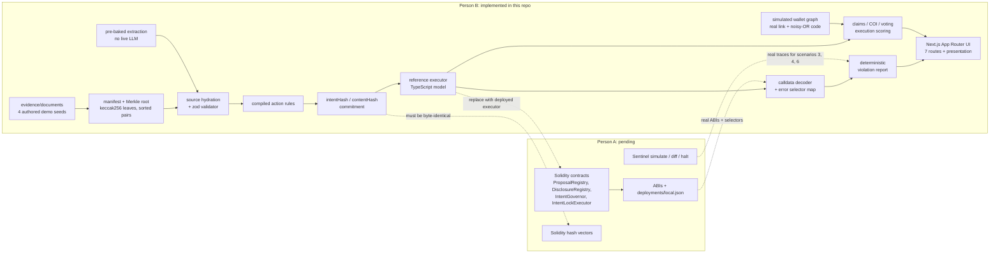

# AegisDAO IntentLock

A decision-integrity console for DAO treasury proposals. A proposal passes a vote; the queued transaction does something else. IntentLock binds the vote to the exact calldata, anchors the evidence behind the proposal, surfaces conflicts of interest, and makes the executor's rejection legible.

The demo proposal is **AIP-042, "Ecosystem Growth Grant — GrowthLabs × Developer Guild"**, requesting **250,000 USDC**. The committed intent authorizes two one-time transfers and a bounded allowance. The queued transaction is an uncommitted `upgradeTo(maliciousImpl)` on the treasury proxy. The reference executor rejects it with `SelectorNotAuthorized`.

The problem is not that votes are secret. It is that **voting transparency is not informed consent**: a voter can see the forum post, the delegate tally and the timelock, and still have no idea which bytes will execute. IntentLock makes the gap between "what the proposal said" and "what the transaction does" the primary artifact.

> Voting transparency isn't informed consent. We made the vote bind to the exact action, and we make the evidence, the conflicts, and the execution verifiable.

**Stack:** Next.js 16 App Router, React 19, Tailwind v4, viem 2, zod 4, Vitest 5, lucide-react. Fonts are bundled via `@fontsource`; the demo makes no network calls.

> **New here?** Read [`docs/PROJECT-STATUS.md`](docs/PROJECT-STATUS.md) first — one page covering verified state, the honesty ledger, what is blocked on Person A, and the environment gotchas.

---

## What is real, what is simulated, what is pending

This is a hackathon demo, not a deployed governance system. There are **no Solidity contracts, no Hardhat, no chain, and no live LLM** in this workspace.

| Area | Status | Honest detail |
| :--- | :--- | :--- |
| Evidence hashing and Merkle proofs | **Real** | Four authored demo documents are hashed with `keccak256(UTF-8 bytes)`; the sorted-pair Merkle root and per-document proofs verify in the browser and in tests. The documents are demo seeds, not real forum captures. |
| Extraction validator and resolution flow | **Real** | Zod schemas plus source-quote hydration. A claim without a matching document quote is rejected. Reviewer resolutions rebuild the rule set and hashes live. |
| Intent / content / commitment hashing | **Real code** | TypeScript implementation of the documented scheme. Byte parity with Solidity is **not proven**. |
| AI extraction | **Simulated / pre-baked** | `intent.extracted.json` and `claims.json` are fixtures. No model is called at demo time. The same schema is used by the would-be live path. |
| Reference executor | **Real model, not EVM** | `reference/executor.ts` is a TypeScript model of rule enforcement, commitment matching, version/chain/timelock checks and post-conditions. It executes nothing on-chain. |
| Calldata decoder and error mapping | **Real** | ERC-20, proxy, Ownable and multicall ABIs are decoded locally; unknown selectors are flagged, never hidden. Error selectors map to stable names and human text. |
| Violation report | **Real, deterministic** | Assembled from the run result, not from LLM prose. |
| Wallet graph math | **Real** | Direct-transfer, common-funder and time-correlation detectors; strengths, disclosure damping and noisy-OR aggregation are code. |
| Wallet graph data | **Simulated** | Addresses, amounts, timestamps, block numbers and tx hashes are fixture data labeled `SIMULATED DATA`. They are not chain records. |
| Voting / claims / COI scoring | **Real code over fixtures** | Formulas run on fixture votes and the graph output. Votes are not read from a chain. |
| Queued transaction and tx hashes | **Simulated** | The executor hash is derived deterministically from scenario id, calldata and block. No transaction was broadcast. |
| Disclosure challenge | **Simulated status, real payload** | "Filed" is fixture state. The challenge payload, digest and cited evidence edges are computed. The flag is raised only when the graph reaches the red threshold; a sub-threshold challenge raises no flag. On-chain verification is pending Person A. |
| Sentinel trace | **Fixture** | `sentinel-trace-06.json` is explicitly labeled a simulated trace. The verdict is derived by walking its call tree for `DELEGATECALL`, never from the scenario's layer label. Fork simulation and guardian halt are pending Person A. |
| Solidity executor, governor, registries | **Pending Person A** | No contracts exist here. Nine scorecard properties are `TEST_REQUIRED`, shown amber and never green. |
| Solidity/TypeScript hash parity | **Pending Person A** | `hash-vectors.json` contains **TypeScript reference vectors** only. |
| Real per-scenario evidence and Hardhat scorecard | **Pending Person A** | Current fixtures and scorecard come from the reference model. |

Current verification state: **57 Vitest tests in 9 files pass**. The reference scorecard is **25 PASS, 0 FAIL, 9 TEST_REQUIRED**.

---

## Quickstart

Requires Node.js 22.12+ (tested on Node 24) and npm. No network access is needed at demo time; fonts are bundled via `@fontsource`.

```bash
npm install

npm run dev          # http://localhost:3000
npm test             # 57 tests, 9 files
npm run test:watch   # watch mode
npm run scorecard    # regenerates fixtures/scorecard.json + scorecard-meta.json
npm run arena -- 3   # runs scenario 3 (jargon upgrade) and prints raw evidence
npm run evidence:build
npm run vectors
npm run errors
npm run typecheck
npm run lint
npm run build
npm run start        # serve the production build on http://localhost:3000
```

Useful read-only check:

```bash
npm run demo:check
```

It prints validation, hashes, scores, versions, the treasury brief and all scenario verdicts without writing fixtures.

> `scorecard`, `evidence:build`, `vectors` and `errors` overwrite fixtures. Run them intentionally, then re-run `npm test`.

---

## Demo path (7 app routes + presentation)

| Route | What it shows |
| :--- | :--- |
| `/` | Decision Trail: Claims → COI → Voting → Execution, the queued-call verdict, and the said-vs-does gap. |
| `/intent` | Source-linked claims, two unresolved ambiguities, live rule set, treasury brief, and the intent/content/commitment match check. |
| `/timeline` | Three hash-chained versions, version diffs, four anchored evidence documents with local verification, and the signed disclosure. |
| `/graph` | Disclosed vs discovered wallets, four scored links, noisy-OR risk, and the disclosure-challenge payload. |
| `/vote` | Risk brief and informed-vote receipt with quorum, support, informed ratio, concentration and flagged-wallet overlap. |
| `/arena` | Eleven red-team scenarios with layer labels; run an attack and see `PASSED`, `REJECTED` or `FLAGGED`. |
| `/scorecard` | The 25 PASS / 0 FAIL / 9 TEST_REQUIRED governance-security scorecard. |

| `/present` | Seven-slide cinematic deck for a projector: verdict, trail, gap, conflict, vote, execution, honesty. |

**Judge Mode:** click **Judge** in the header. The bottom bar walks the seven stops with Next/Back, `Alt+←/→`, `Esc` to exit, and **Present** to open the deck.
**Presentation:** `/present` runs fully offline; arrow keys or space advance, `F` toggles fullscreen, and the final slide downloads the report.
**Takeaway:** any report page has a **Takeaway** panel that downloads a self-contained HTML report or a machine-readable JSON bundle.

`/arena/[id]` opens a single violation report; the primary demo report is `/arena/03-jargon-upgrade`.

---

## Architecture



The execution guarantee is designed to be on-chain; in this workspace it is a deterministic TypeScript model. Simulation (Sentinel) is early warning, never the guarantee.

---

## Repo map

| Path | Role |
| :--- | :--- |
| `app/` | Next.js 16 App Router pages, including the seven demo routes, `/present`, and client views. |
| `components/` | Shared UI: app shell, stage pipeline, source chips, status pills, layout primitives. |
| `lib/demo.ts` | Builds the single cached demo object: hydration, hashes, graph, scores, all scenario runs. |
| `ai/` | Extraction validation, reviewer resolutions, treasury brief. |
| `evidence/` | Seed documents and Merkle tree/proof implementation. |
| `packages/shared/` | Frozen schemas, addresses, ABI fragments, calldata builders, hashing, evidence helpers, hash vectors, fixtures. |
| `reference/` | TypeScript reference executor, error encoding, run/scenario types. |
| `sentinel/` | Calldata decoder and deterministic violation report. |
| `graph/` | Link discovery, disclosure damping, noisy-OR risk, challenge payload. |
| `chain-scoring/` | Claims, COI, voting and execution stage scoring plus the Decision Trail. |
| `scripts/` | Evidence build, vector/error generation, scorecard, arena runner, demo consistency check. |
| `tests/` | Nine Vitest files covering hashing, evidence, AI validation, decoding, executor, report export, reporting, graph and scoring. |
| `docs/` | Project status brief, demo script, Person A handoff and direction, and the independent audit. |

---

## Scoring formulas and thresholds

All scores are in `[0, 1]`. Claims, COI and voting are advisory; execution is a hard gate.

| Stage | Formula | Status thresholds |
| :--- | :--- | :--- |
| **Claims** | `mean(confidence_i × (1 if its ambiguity resolved else support_i)) × 1/(1 + 0.12 × open) × (1 − 0.05 × resolved)` | GREEN ≥ 0.80, AMBER ≥ 0.60, else RED |
| **COI** | `R = 1 − Π(1 − s_j)` with `s_j = base_j × (0.35 if every endpoint is disclosed, else 1)`; bases: direct transfer 0.48, common funder 0.38, time-correlated 0.27 | RED ≥ 0.65, AMBER ≥ 0.35, else GREEN (higher risk is worse) |
| **Voting** | `0.30 × quorumHealth + 0.20 × supportRatio + 0.35 × informedRatio + 0.15 × (1 − HHI) − 0.05 × overlap` | GREEN ≥ 0.80, AMBER ≥ 0.55, else RED |
| **Execution** | `score = null`; `PASSED` → GREEN, otherwise RED | Binary. No averaging with the advisory stages. |

Voting details: `quorumHealth = min(1, cast / quorum)`, quorum is 4,000 bps; `supportRatio = FOR / (FOR + AGAINST)`; `informedRatio` is weight that saw the **current** brief version; HHI is computed over FOR weight; the penalty applies if any FOR voter overlaps a flagged wallet. Disclosed link endpoints are damped, not ignored.

Current AIP-042 values:

| Stage | Score | Status | Why |
| :--- | ---: | :--- | :--- |
| Claims | 0.81 | GREEN | 6 retained claims, 2 ambiguities resolved, tentative claim `c6` removed |
| COI | 0.88 | RED | 4 links; noisy-OR above 0.65 |
| Voting | 0.71 | AMBER | informed ratio 59%; one 90,000-weight FOR voter overlaps a flagged wallet |
| Execution | — | RED | `SelectorNotAuthorized`; hard gate |

The claims score **as extracted** is 0.63 (AMBER): 7 active claims and 2 open ambiguities. Review moves it to 0.81. The graph detectors implemented are direct transfer, common funder and time correlation; `SHARED_DEPLOYER` exists only as a type placeholder.

---

## Hash and commitment scheme

`packages/shared/hash.ts` is the single hashing entry point. Do not reimplement it in UI code.

| Value | Construction |
| :--- | :--- |
| `ruleHash` | `keccak256(abi.encode(uint8 kind, address target, bytes4 selector, address counterparty, uint256 maxAmount, bytes32 codeHash, bytes32 childrenHash))`; `childrenHash` is `keccak256(abi.encode(bytes32[] childRuleHashes))`, zero for leaves. |
| `intentHash` | `keccak256(abi.encode(bytes32[] ruleHashes))` over the compiled rules. Sources and confidence do **not** enter it. |
| `contentHash` | `keccak256(UTF-8 canonical JSON)` of proposalId, version, title, projected actions and assumptions sorted by name. This is the version content hash. |
| `actionsHash` | `keccak256(abi.encode((address target, uint256 value, bytes data)[]))` over concrete calls. |
| `evidenceRoot` | Merkle root of `keccak256(UTF-8 doc text)` leaves; parent is `keccak256(sorted(a, b))`, odd leaf duplicated. |
| `disclosureHash` | `keccak256(UTF-8 canonical JSON)` of proposalId, proposer, lowercased sorted wallets, statement, signedAt. |
| `commitment` | `keccak256(abi.encode(uint256 chainId, address executor, bytes32 proposalKey, uint256 version, bytes32 actionsHash, bytes32 intentHash, bytes32 evidenceRoot, bytes32 disclosureHash))`, where `proposalKey = keccak256(UTF-8 proposalId)`. |
| `briefHash` | `keccak256(UTF-8 canonical JSON)` of proposalId, version, intentHash, contentHash, evidenceRoot. |

The commitment therefore binds chain id, executor address, proposal key, version, concrete calldata, compiled rules, evidence root and disclosure. A wording-only change can leave `intentHash` unchanged while moving `contentHash`, the evidence root and the commitment.

**Parity caveat:** `hash-vectors.json` contains TypeScript reference vectors (`intentHash`, `actionsHash`, `contentHash`, `disclosureHash`, `commitment`, `briefHash`). Solidity byte-parity remains `TEST_REQUIRED` (scorecard `P1`).

---

## Fixtures and regeneration

Everything the UI reads lives in `packages/shared/fixtures/`.

| Fixture | Contents | Regenerate with |
| :--- | :--- | :--- |
| `evidence-manifest.json` | Four documents, hashes, bytes, text, Merkle root, proofs | `npm run evidence:build` |
| `intent.extracted.json`, `intent.committed.json`, `claims.json` | Pre-baked extraction and reviewer-resolved intent | Hand-authored seeds |
| `proposal.json`, `votes.json`, `graph.json`, `attention.json` | Proposal metadata, vote fixture, simulated wallet graph, attention queue | Hand-authored seeds |
| `scenarios.json` | 11 red-team scenarios and expected verdicts | Hand-authored seeds; Person A replaces with real evidence |
| `sentinel-trace-06.json` | Labeled simulated DELEGATECALL trace | Person A replaces with a real trace |
| `errors.json` | Stable custom-error selector map | `npm run errors` |
| `hash-vectors.json` | TypeScript reference vectors | `npm run vectors` |
| `scorecard.json`, `scorecard-meta.json` | 34 properties and summary counts | `npm run scorecard` |

Determinism notes: evidence hashes, vectors and scorecard entries are deterministic given the seed files. `generatedAt` timestamps in the manifest and scorecard metadata change on regeneration. The scorecard runs in-process against the reference model; it is not a Hardhat run.

---

## Prior art and positioning

Vote-to-calldata binding is **already solved**: OpenZeppelin and Compound governors derive the proposal id from the encoded calls, so the vote is over the exact bytes. Do not claim that as novel — in the Tornado Cash takeover the malicious calldata *was* in the proposal.

What is not solved is that nobody could read those bytes, nothing required the description to match them, and the code at an approved address can change after approval. That is the gap this project works in. It is also measured: *Understanding Security Issues in the DAO Governance Process* (IEEE TSE 2025) asks exactly whether proposals keep descriptions consistent with code, and finds **32,500 of the proposals it examined — over 90% — did not**.

The nearest existing neighbour is Zodiac Roles Modifier, which enforces calldata-level permissions at execution — but as a standing *policy* rather than a per-proposal *commitment*. Full comparison and build-order guidance: [`docs/person-a-direction.md`](docs/person-a-direction.md).

---

## Person A handoff

The exact swap points, interface rules and current schemas are in [`docs/person-a-handoff.md`](docs/person-a-handoff.md). Read [`docs/person-a-direction.md`](docs/person-a-direction.md) first for build order, the prior-art boundary and the five traps that break hash parity. In short: Person A must deliver the Solidity contracts and ABIs, a local deployment manifest, stable error selectors, Solidity-generated hash vectors, real evidence fixtures per scenario, Sentinel traces for scenarios 3/4/6, a Hardhat-derived scorecard, and the `npm run arena` bridge. Until then, the UI labels the executor as a reference model and keeps the nine unproven properties amber.

---

## Limitations and non-goals

- **Restricted action model.** Six action kinds only: transfer, approve, parameter set, upgrade, ownership transfer, multicall. This is not a general-purpose arbitrary-call governance system.
- **The TypeScript executor is a model, not a guarantee.** It mirrors the intended rules, but only a deployed, tested Solidity executor can enforce them. Nine on-chain properties are `TEST_REQUIRED`.
- **Simulation is early warning.** Sentinel-style flags help humans act before execution; they are not the security boundary. The executor is.
- **Wallet data is simulated.** Addresses, transfers, timestamps and tx hashes are fixture records labeled `SIMULATED DATA`. The link math is real; the data is not evidence of wrongdoing.
- **AI is advisory.** Extraction is pre-baked; the validator, reviewer confirmation and hashing are real. No live LLM is called. Claims without document spans are rejected, but extraction quality is not proven.
- **No on-chain evidence.** Evidence roots and disclosure hashes are computed locally; nothing is anchored in a registry yet.
- **Voting data is a fixture.** Quorum, weights and brief acknowledgements are not read from `IntentGovernor`.
- **Test coverage is modest and not 80%.** There are 57 tests across 9 files. No coverage threshold is configured, and no coverage claim is made. The scorecard measures specific properties, not line coverage.
- **No live chain and no live LLM at demo time.** The whole demo runs offline from bundled assets and fixtures.
