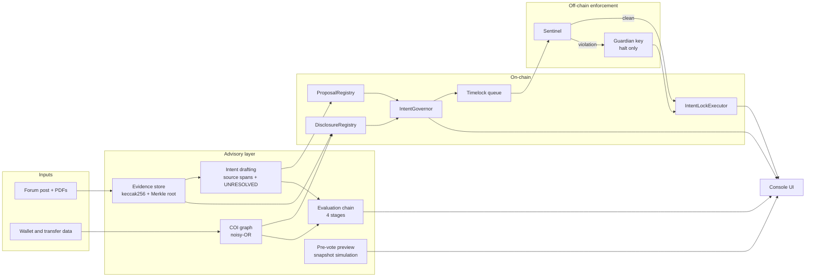
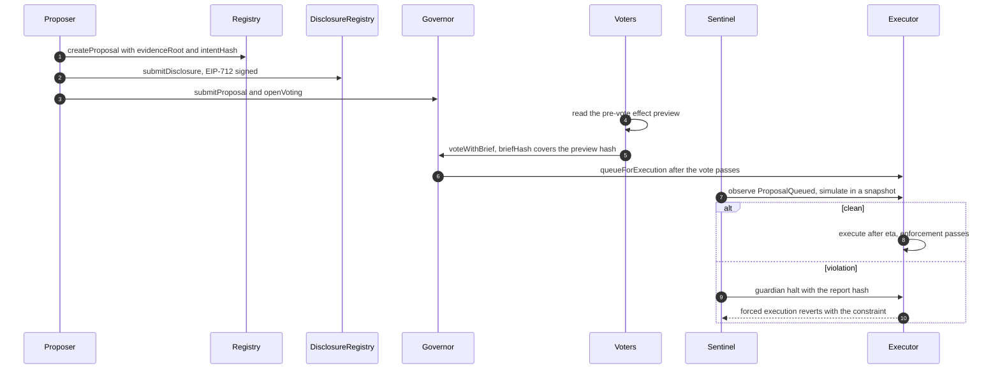
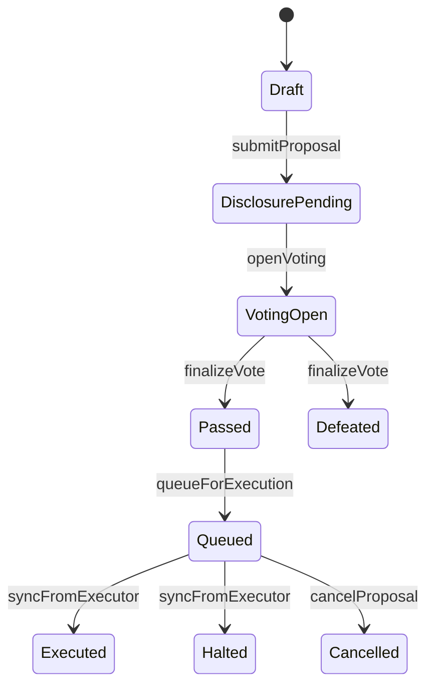

# AegisDAO IntentLock

> **Votes shouldn't authorize a vibe. They should authorize an exact action.**

IntentLock binds a DAO vote to a cryptographic execution commitment: the exact targets,
values, calldata, typed rules, evidence root and conflict-of-interest disclosure. An on-chain
executor refuses anything outside that commitment, a Sentinel simulation explains the gap
before and after the vote, and a pre-vote effect preview shows what the committed bytes would
actually do while there is still time to vote against them.

[-363636?logo=solidity)](contracts/)
[](hardhat.config.ts)
[](console/)
[](#testing)
[%20%2B%20Local-blue)](docs/SEPOLIA.md)
[](#team-license-acknowledgements)

**Hackathon:** CASCADE '26 · **Team:** Aditya Joshi (Chain & Security) · Person B (Intelligence
& Experience) · repository integration by Muse (agent)

> **Hero screenshot — placeholder.** `docs/screenshots/hero-decision-trail.png` — *Decision
> Trail showing the four evaluation stages, the compact "If this passes" verdict and the Live
> Sentinel panel.* Capture list: [docs/screenshots/README.md](docs/screenshots/README.md).
>
> **Demo video — placeholder.** Add the link here before submission. Suggested length: three
> minutes, following [Demo walkthrough](#demo-walkthrough).

## Table of contents

1. [The problem](#the-problem)
2. [Our solution](#our-solution)
3. [Features and status](#features-and-status)
4. [Architecture](#architecture)
5. [Smart contracts](#smart-contracts)
6. [Security model](#security-model)
7. [Probabilistic evaluation chain](#probabilistic-evaluation-chain)
8. [Tech stack](#tech-stack)
9. [Repository structure](#repository-structure)
10. [Getting started](#getting-started)
11. [Sepolia testnet](#sepolia-testnet)
12. [Hardware-wallet signing](#hardware-wallet-signing)
13. [Troubleshooting](#troubleshooting)
14. [Demo walkthrough](#demo-walkthrough)
15. [Testing](#testing)
16. [Roadmap](#roadmap)
17. [Team, license, acknowledgements](#team-license-acknowledgements)

---

## The problem

> **The Governance Illusion: DAO Accountability**

The hackathon asks for verifiable proposals, decision intelligence with traceable references,
forced conflict-of-interest disclosure, execution accountability, live handling of a contested
upgrade with an obfuscated payload, and a Probabilistic Evaluation Chain from **Proposal
Claims → Conflict-of-Interest Risk → On-Chain Voting → Execution Discrepancy**. The checklist
below is quoted from the team's problem mapping in
[`aegisdao_intentlock_final_blueprint_v2.md`](aegisdao_intentlock_final_blueprint_v2.md).

Transparent on-chain voting is not informed consent. A voter can read the forum post, see the
delegate tally and watch the timelock count down, and still have no idea which bytes will run.
The description is a separate string from the calldata, evidence lives in PDFs and forum
threads nobody re-checks, conflicts of interest are self-reported or invisible, and the code at
an approved address can change after approval. OpenZeppelin and Compound governors have bound
votes to calldata since 2020; in Tornado Cash (May 2023) the malicious calldata *was* in the
proposal and the vote *did* bind to it. What failed was comprehension, evidence and code
identity at execution time.

### The scenario this repository is built around

A proposal titled **"Routine parameter tuning"** asks to set a fee parameter. The text, the
evidence bundle and the human-confirmed intent all describe a bounded `setFee(35)` call. The
committed calldata is actually a `multicall` that installs a malicious implementation on the
treasury proxy and transfers its ownership to an attacker wallet. Under a normal governor this
passes and executes. Under IntentLock the executor reverts, the Sentinel halts during the
timelock, and the pre-vote effect preview shows the owner and implementation changes **before
anyone votes**.

### Requirement checklist

- [x] Verifiable proposals: versions, financial assumptions, technical assessments, tamper-evident history
- [x] Decision intelligence: summaries with traceable references
- [x] Conflict-of-interest: forced disclosure and mapped wallet connections
- [x] Execution accountability: approved decision compared with actual execution
- [x] Live contested upgrade with an obfuscated payload: parse, simulate, halt or flag
- [x] Probabilistic Evaluation Chain: Claims → COI → Voting → Execution Discrepancy
- [x] No central authority can edit proposal history or hide evidence

---

## Our solution

A proposal is not a description plus a transaction. It is a **commitment**: the hash of the
exact execution package, anchored to a hash-chained version, an evidence Merkle root and the
proposer's disclosure. The vote authorizes that hash. At execution time the executor recomputes
it from the submitted bytes and enforces every action against typed rules derived from the
committed intent. The description can no longer drift from the code, because the description's
hash is part of what was signed.

Three layers are kept deliberately separate:

- **Protected Executor** — deterministic and on-chain. It blocks.
- **Sentinel** — deterministic simulation and tracing. It warns and can trigger a guardian halt.
- **Intent drafting, scoring and preview commentary** — advisory. Humans confirm; nothing here
  can approve or execute.

### How it maps to the problem

| Requirement | Component | Where |
| :--- | :--- | :--- |
| Tamper-evident proposal versions | Hash-chained `ProposalRegistry` | [`contracts/ProposalRegistry.sol`](contracts/ProposalRegistry.sol) |
| Evidence behind claims | Content-addressed store + Merkle manifest, source verification | [`intelligence/evidence.ts`](intelligence/evidence.ts) |
| Source-linked decision intelligence | Intent drafting with spans and `UNRESOLVED` flags, human confirmation | [`intelligence/ai-draft.ts`](intelligence/ai-draft.ts) |
| Forced conflict disclosure | `DisclosureRegistry` (EIP-712, bond, challenges) | [`contracts/DisclosureRegistry.sol`](contracts/DisclosureRegistry.sol) |
| Mapped wallet connections | Disclosed-vs-discovered graph with noisy-OR scores | [`intelligence/graph.ts`](intelligence/graph.ts) |
| Execution accountability | Execution commitment + typed rule enforcement | [`contracts/IntentLockExecutor.sol`](contracts/IntentLockExecutor.sol) |
| Live contested upgrade | Decode, bytecode scan, snapshot simulation, trace diff, guardian halt | [`sentinel/`](sentinel/) |
| Pre-vote understanding | Effect preview of the exact committed calldata | [`sentinel/preview.ts`](sentinel/preview.ts) |
| Evaluation chain | Four-stage scorer with per-stage reasons and factors | [`intelligence/chain.ts`](intelligence/chain.ts) |
| Red-team evidence | Eleven scenarios, scorecard generated from real tests | [`test/redteam/`](test/redteam/) |

### What makes it different

1. **It blocks instead of flagging.** The executor reverts uncommitted shapes; the dashboard is
   not the enforcement.
2. **The commitment covers the full package** — actions, rules, evidence root, disclosure,
   version, chain and executor address — not just the calldata.
3. **Three separated layers** with explicit trust levels, so an AI or a simulation can never
   widen the gate.
4. **Forced disclosure plus discovered links**, with a bonded challenge that blocks voting when
   verified.
5. **A deterministic execution gate over advisory scores.** No upstream score can override an
   execution mismatch.
6. **Pre-vote effect preview.** Voters see the simulated state changes of the exact committed
   calldata, and `voteWithBrief` records the hash of the preview they acknowledged.
7. **EIP-712 typed votes and halts that can be relayed**, so the signer can be a Ledger or a
   browser wallet while a funded relayer submits the transaction.

---

## Features and status

**Implemented** = code and tests in this repo · **Partial** = the core works but a stated
sub-capability is missing, and the gap is named · **Planned** = not built.

### Verifiable proposals

| Feature | Status | Evidence / gap |
| :--- | :--- | :--- |
| Append-only, hash-chained proposal versions | Implemented | `ProposalRegistry.sol`; chain checks in `test/preview.test.ts` |
| Evidence Merkle manifest and per-document proofs | Implemented | `intelligence/evidence.ts`, 44 intelligence tests |
| Source re-hash verification in the UI | Partial | Recorded mode only; live evidence endpoints are not wired (`liveUnavailable` in `app/lib/data.ts`) |

### Execution commitment and Protected Executor

| Feature | Status | Notes |
| :--- | :--- | :--- |
| Commitment over actions, rules, evidence, disclosure, version, chain, executor | Implemented | `IntentLockExecutor._computeCommitment` |
| Typed rules with unknown-selector rejection | Implemented | `ActionDecoder.enforce` |
| Recursive multicall checks (depth ≤ 2) | Implemented | Deeper nesting is rejected |
| Bounded approvals; unlimited approvals rejected unless committed | Implemented | `UnlimitedApprovalNotCommitted` |
| Upgrade code-hash pinning (`extcodehash` at execution) | Implemented | `CodeHashMismatch` |
| Post-conditions after execution | Partial | ERC-20 allowance ceilings only; owner/admin, balance delta and EIP-1967 are not re-asserted after the call |
| Timelock, one-shot execution, reentrancy guard | Implemented | `TimelockNotExpired`; executed flag set before external calls; `nonReentrant` |
| Replay and stale-version protection | Implemented | `chainId` in the commitment; `VersionSuperseded` |
| Guardian halt only (`halt`, `haltBySig`) | Implemented | The guardian can also call `setGovernor`; see [SECURITY.md](docs/SECURITY.md#assumptions) |

### Forced disclosure and conflict-of-interest graph

| Feature | Status | Notes |
| :--- | :--- | :--- |
| On-chain signed disclosure; voting cannot open without it | Implemented | EIP-712 `Disclosure` |
| Bond plus challenge flow; a verified challenge blocks voting | Implemented | `fileChallenge`, `verifyChallenge`, `DisclosureChallenged` |
| Disclosed-vs-discovered links, noisy-OR risk, per-link evidence | Implemented | `intelligence/graph.ts` — data is **SIMULATED** |
| Live graph from real chain data | Planned | The demo dataset is clearly labeled SIMULATED DATA |

### Decision intelligence

| Feature | Status | Notes |
| :--- | :--- | :--- |
| Source-linked claims with `UNRESOLVED` flags | Implemented | Deterministic heuristic extractor |
| Human confirmation producing `intentHash` and compiled rules | Implemented | `intelligence/intent-bridge.ts` |
| Live LLM extraction at demo time | Planned | Drafts are **PRE-BAKED** fixtures or the heuristic; no model is called |
| Local benefit classifier and `npm run decide` CLI | Implemented | Logistic regression, no network (`intelligence/tiny-model.ts`, 29 tests) |

### Sentinel and pre-vote preview

| Feature | Status | Notes |
| :--- | :--- | :--- |
| Calldata decode with a recursive multicall tree | Implemented | Unknown selectors are flagged, never hidden |
| Bytecode scan (DELEGATECALL, SELFDESTRUCT, CALLCODE) | Implemented | `sentinel/scan.ts` |
| Snapshot simulation, state diff, call trace, revert | Implemented | Requires `evm_snapshot` (Hardhat or `FORK=1`) |
| Guardian halt with a violation report hash | Implemented | Software key or EIP-712 `haltBySig` |
| Watcher from the deployment block with rate-limit retries | Implemented | `sentinel/watcher.ts` |
| Pre-vote effect preview of the committed calldata | Implemented | `sentinel/preview.ts`, API and UI, 9 tests |
| Preview on Sepolia | Implemented | Runs on a `FORK=1` Sepolia fork, never on the public RPC |

### Probabilistic evaluation chain

| Feature | Status | Notes |
| :--- | :--- | :--- |
| Four stages with score, status, reason and factors | Implemented | `intelligence/chain.ts`, `/api/evaluation/[proposalId]` |
| Claims and COI formulas | Implemented | Mean of confidence × support; noisy-OR with undisclosed penalty |
| Voting quality (quorum, informed ratio, concentration, COI overlap) | Implemented | Harmonic mean of four signals |
| Deterministic execution gate | Implemented | `D = 0/1`; no upstream score can override it |
| Preview mismatch factor in the chain | Implemented | Added to CLAIMS; VOTING factors reference the preview hash |

### Informed voting and governance UX

| Feature | Status | Notes |
| :--- | :--- | :--- |
| `voteWithBrief` and informed-vote ratio | Implemented | `briefHash` covers the evaluation chain **and** the preview hash |
| Risk brief with treasury impact and unresolved items | Implemented | `/voting` |
| Attention queue ranked by risk | Partial | Recorded data only; the live endpoint throws a named error |
| EIP-712 relayed votes | Implemented | `voteBySig`, `IntentVote`, HS1–HS7 tests |

### Red-Team Arena and scorecard

| Feature | Status | Notes |
| :--- | :--- | :--- |
| Eleven reproducible attack scenarios as tests and console buttons | Implemented | `test/redteam/`, `POST /api/arena/:id` |
| Scorecard generated from real test output | Implemented | `scripts/scorecard-reporter.js`; 11 PASS / 0 FAIL |

### Hardware and tri-mode signing

| Feature | Status | Notes |
| :--- | :--- | :--- |
| Tri-mode signer toggle (Dev, Browser, Ledger) | Implemented | Seamless switching across all three signing paths in `/status`, `/vote`, and `/trail` |
| Ledger connector (DMK + WebHID) for votes and halts | Implemented | Auto `skipOpenApp` session reuse, friendly error mapping for `DeviceLockedError`, `6807`, and `NoAccessibleDeviceError` |
| EIP-712 payloads and relayer submission | Implemented | Relayer pays gas on-chain; user key signs only (`voteBySig`, `haltBySig`); HS1–HS7 and HH1–HH4 tests passing |
| Browser-wallet signing (MetaMask / Rabby) | Implemented | Direct EIP-1193 / EIP-712 signing with automatic chain-switching to Sepolia (11155111) |
| Dev-signer fallback | Implemented | Server-side role signers (Voter 1–3, Guardian) pre-configured with testnet keys in `.env` |

### Console pages

Two frontends live in this repository:

| App | Routes | Purpose |
| :--- | :--- | :--- |
| `app/` (contract-wired console) | `/` Decision Trail · `/proposals` · `/arena` · `/disclosure` · `/voting` · `/scorecard` · `/status` | Live or recorded data from the deployed contracts, the Sentinel feed and the preview API |
| `console/` (editorial console) | `/` atlas · `/report` · `/trail` · `/live` · `/vote` · `/graph` · `/intent` · `/arena` · `/scorecard` · `/status` | Editorial presentation, the reference model, and the Ledger signing path |

Data is always labeled: **LIVE** (read from the running chain), **RECORDED** (captured from a
completed run), **SIMULATED** (wallet graph), **PRE-BAKED** (AI drafts).

---

## Architecture

Full diagrams, both state machines and the module map: [ARCHITECTURE.md](docs/ARCHITECTURE.md).







The executor has its own five-state machine (`Empty`, `Queued`, `Executed`, `Halted`,
`Cancelled`); see [ARCHITECTURE.md](docs/ARCHITECTURE.md#proposal-state-machines).

### Three enforcement layers

| Layer | Role | Trust level |
| :--- | :--- | :--- |
| Protected Executor (`IntentLockExecutor` + `ActionDecoder`) | Reverts anything outside the commitment and policy | Cryptographic and deterministic. This is the security claim. |
| Sentinel (`sentinel/`) | Early warning: decode, scan, simulate, diff, trace, halt | Deterministic, limited to what simulation observes |
| Drafting, scoring, preview text (`intelligence/`, `sentinel/preview.ts`) | Explain and compare for humans | Advisory only; humans confirm; nothing executes from here |

### The commitment

```text
commitment = keccak256(abi.encode(
  COMMIT_TYPEHASH, chainId, executor, proposalId, version,
  versionHash, actionsHash, intentHash, disclosureHash
))
```

Every field is load-bearing: changing a target, value, byte of calldata, rule, disclosure,
version, chain or the executor address changes the commitment, so execution fails. Details and
the `Version` struct: [CONTRACTS.md](docs/CONTRACTS.md#the-commitment).

---

## Smart contracts

| Contract | Purpose | Notable properties |
| :--- | :--- | :--- |
| [`ProposalRegistry`](contracts/ProposalRegistry.sol) | Hash-chained versions | Append-only; `verifyChain` recomputes the chain |
| [`DisclosureRegistry`](contracts/DisclosureRegistry.sol) | Forced disclosure and challenges | EIP-712; bond slashed to a verified challenger |
| [`IntentGovernor`](contracts/IntentGovernor.sol) | Vote on a commitment | Commitment fixed at `openVoting`; `voteWithBrief`; `voteBySig` |
| [`IntentLockExecutor`](contracts/IntentLockExecutor.sol) | Queue, verify, enforce, execute, halt | Recomputed commitment; executed flag before calls; `halt`/`haltBySig` |
| [`ActionDecoder`](contracts/libs/ActionDecoder.sol) | Typed rule enforcement | Only `call`; unknown selectors rejected; depth ≤ 2 |
| [`CommitmentHasher`](contracts/CommitmentHasher.sol) | Reference hasher | Ground truth for TypeScript parity |

Deployed addresses (local and Sepolia, with Etherscan links), the full 46-error catalog and the
EIP-712 type table are in [CONTRACTS.md](docs/CONTRACTS.md).

---

## Security model

Full threat model, assumptions and limits: [SECURITY.md](docs/SECURITY.md).

### Arena results (latest run in this workspace)

Twenty scenario tests passing; scorecard **11 PASS / 0 FAIL**. Regenerate with `npm run arena`.

| # | Attack | Result |
| :--- | :--- | :--- |
| 0 | Benign 5,000 USDC transfer | PASS (executes) |
| 1 | Recipient swap after the vote | PASS (reverts) |
| 2 | Amount inflation | PASS (reverts) |
| 3 | Jargon upgrade | PASS (reverts) |
| 4 | Hidden ownership transfer in a multicall | PASS (reverts) |
| 5 | Unlimited approval | PASS (reverts) |
| 6 | Delegatecall payload | PASS (not executable) |
| 7 | Re-entrancy | PASS (reverts) |
| 8 | Early, double and cross-chain execution | PASS (reverts) |
| 9 | Stale version | PASS (reverts) |
| 10 | Hidden conflict of interest | PASS (flagged) |

### What this does NOT catch

- A vote that **honestly authorizes something bad** still executes.
- Evidence that is **self-authored but internally consistent** is not proven true.
- A **compromised governor, executor or guardian** breaks the guarantee (the guardian can also
  rotate the governor today).
- **Arbitrary-bytecode safety** is not claimed; only the typed action model is enforced.
- Post-conditions cover **allowance ceilings only**; owner, balance and EIP-1967 slots are not
  re-asserted after the call.
- Simulation is **early warning**, not the guarantee; the wallet graph is **simulated data** with
  heuristic scores; AI drafts are **pre-baked or heuristic** and human-confirmed.
- There is **no audit and no formal verification**; the Sepolia deployment is a testnet demo.

---

## Probabilistic evaluation chain

| Stage | Input | Method | Output | Can tell you | Cannot tell you |
| :--- | :--- | :--- | :--- | :--- | :--- |
| Claims `C` | Extracted actions with confidence and evidence support | `C = mean(c_i)`, `c_i = extraction_confidence_i × evidence_support_i`; unresolved counts as 0 | 0–1 plus unresolved and unsupported counts | How grounded the claims are | Whether the documents are true |
| COI `R` | Wallet links with strengths `s_j` | `R = noisyOr(s_j) × (1 + 0.5 × undisclosed_fraction)`, capped at 1; `noisyOr = 1 − Π(1 − s_j)` | 0–1 plus per-link evidence | Potential conflicts worth scrutiny | Intent or corruption |
| Voting `V` | Quorum margin, informed ratio, concentration, COI overlap | Harmonic mean of four signals in `[0,1]` | 0–1 plus factors | Vote quality and informed participation | Whether voters understood the code |
| Execution `D` | Executor or Sentinel result | Deterministic: 0 if executed actions match the commitment and policy, 1 otherwise | 0 or 1 | Whether the bytes ran | Why humans approved them |

Execution is deterministic because it is computed from chain state and the commitment, not from
a model. Upstream scores are advisory; `D = 1` halts regardless of how good the scores look.

Link strengths: direct transfer `0.8`, shared deployer `0.7`, common funder `0.65`,
time-correlated transfers `0.45`, damped when disclosed. Thresholds and every weight live in
`CONFIG` at the top of [`intelligence/chain.ts`](intelligence/chain.ts).

---

## Tech stack

| Layer | Technology | Version |
| :--- | :--- | :--- |
| Contracts | Solidity | 0.8.24 (evm target `cancun`) |
| Contracts | OpenZeppelin Contracts | 5.6.1 |
| Chain tooling | Hardhat | 2.29.1 (installed; manifest range `^2.22.0`) |
| Chain tooling | ethers | 6.17.0 |
| Tests | Mocha and Chai via hardhat-toolbox; ts-mocha | toolbox 5.x |
| Console (`app/`) | Next.js, React, Tailwind CSS | 16.4.3, 19.3.1, v4 |
| Console (`app/`) | d3-force | 3.x |
| Console (`console/`) | Next.js, React, Tailwind, viem, zod, Vitest | 16.4.3, 19.3.0, v4, 2.x, 4.x, 5.x |
| Hardware | Ledger Device Management Kit and WebHID | see `console/package.json` |
| Runtime used for verification | Node.js and npm | v24.18.0 and 11.16.0 |

---

## Repository structure

```text
.
├── contracts/                 Solidity: registry, disclosure, governor, executor, decoder
│   ├── libs/ActionDecoder.sol Typed rule enforcement
│   └── test-helpers/          MockUSDC, FeeModule, proxies, malicious and reentrant helpers
├── test/                      Hardhat suites: parity, preview, sentinel, helpers
│   └── redteam/               Scenarios 0-10, EIP-712 signature flows, fixtures
├── sentinel/                  Decode, scan, simulate, diff, trace, halt, watcher, preview, mutex
├── intelligence/              Evidence, intent drafting, COI graph, evaluation chain, classifier
├── packages/shared/           Hash parity, error catalog, schemas, fixtures and recorded previews
├── app/                       Contract-wired Next.js console (Decision Trail, Voting, Arena, ...)
├── console/                   Editorial console, atlas, report and Ledger signing
├── scripts/                   Deploy, seed, verify, preview recording, arena, decision CLI
├── deployments/               Generated manifests: addresses, ABIs, constructor args, blocks
├── docs/                      ARCHITECTURE, SECURITY, CONTRACTS, SEPOLIA, HARDWARE, screenshots
├── public/                    Static editorial pages served by console/
├── hardhat.config.ts          Solidity, localhost, Sepolia, optional FORK=1 fork
├── package.json               npm scripts for every gate and demo step
└── .env.example               Every environment variable, with placeholders
```

---

## Getting started

Verified on a clean clone with **Node.js v24.18.0** and **npm 11.16.0**. No `.env` is required
for the local demo.

### Prerequisites

- Node.js 20 or later (24.x used for verification)
- npm 10 or later
- Git
- Two terminals for the demo, three if you want the Sentinel visible while the app runs

### 1. Install and run the contract gates

```bash
git clone https://github.com/BeastAyyG/CODE_TANTRAFEST
cd CODE_TANTRAFEST
npm ci
npx hardhat compile
npx hardhat test
```

Expected:

```text
added 641 packages
Compiled 21 Solidity files successfully (evm target: cancun).
68 passing
```

Other suites:

```bash
npm run test:intelligence   # 44 passing
npm run test:decide         # 29 passing
npm run test:parity         # 14 passing (subset of the 68)
```

### 2. Start the local chain

Terminal A:

```bash
npx hardhat node
```

### 3. Deploy and seed the demo

Terminal B:

```bash
npm run deploy
GUARDIAN_MODE=auto npm run seed
```

`npm run deploy` prints a gas estimate before sending, then every address and block. The seed
produces six demo proposals:

```text
P1 Q4 Development Grant                   -> Executed
P2 Routine parameter tuning               -> Halted
P3 Ecosystem grant with hidden link       -> Challenged
P4 Infrastructure budget                  -> VotingOpen
P5 Community Grants Expansion             -> Drafted
P6 Routine parameter tuning (obfuscated)  -> VotingOpen
```

`GUARDIAN_MODE=auto` submits the guardian halt itself. The default is `hardware`, which leaves
P2 `Queued` with a pending Sentinel report so a hardware guardian can sign the halt
([HARDWARE.md](docs/HARDWARE.md)). PowerShell:

```powershell
$env:GUARDIAN_MODE="auto"; npm run seed
```

### 4. Start the Sentinel (recommended)

Terminal C:

```bash
npm run sentinel:watch
```

Expected:

```text
AEGIS SENTINEL WATCHER
  Network:    local (chain 31337)
  Executor:   0x...
  Guardian:   0x... (halt-only)
  Watch from: block <deployment block>
```

### 5. Run the console

```bash
cd app
npm ci
npm run build
npm run start
```

Open <http://localhost:3000>. Expected:

- `/status` shows RPC reachable, chain 31337, chain-id match, and every contract with code.
- `/` shows the Decision Trail, the compact "If this passes" preview and the Sentinel panel.
- `/voting` with proposal #6 selected shows a crimson **"5 effects outside the stated intent"**
  banner with CRITICAL owner and implementation rows, before any vote.

### Environment variables

Copy [`.env.example`](.env.example) to `.env` only when you need testnet or role keys; `.env` is
gitignored.

| Variable | Purpose | Example | Required |
| :--- | :--- | :--- | :--- |
| `SEPOLIA_RPC_URL` | Sepolia RPC for deploy, verify and fork | `https://sepolia.infura.io/v3/<key>` | Sepolia |
| `ETHERSCAN_API_KEY` | Contract verification | `<key>` | Sepolia verify |
| `DEPLOYER_KEY` | Deployer and relayer key | `0x...` | Sepolia |
| `PROPOSER_KEY`, `VOTER1_KEY`, `VOTER2_KEY`, `VOTER3_KEY` | Demo role signers | `0x...` | Sepolia seed |
| `GUARDIAN_KEY` | Software guardian halt and Sentinel halt | `0x...` | Sentinel on Sepolia |
| `GUARDIAN_ADDRESS` | Hardware-wallet guardian | `0x...` | Optional |
| `VERIFIER_KEY`, `CHALLENGER_KEY` | Disclosure challenge roles | `0x...` | Sepolia seed |
| `DEV_WALLET_ADDRESS`, `VENDOR_ADDRESS`, `ATTACKER_ADDRESS` | Demo recipients | `0x...` | Optional |
| `TIMELOCK_DELAY_SECONDS`, `VOTING_PERIOD_SECONDS`, `CHALLENGE_WINDOW_SECONDS`, `CHALLENGE_EXTENSION_SECONDS`, `MAX_DELAY_SECONDS` | Testnet timing | `120`, `300`, `1800`, `3600`, `1209600` | Optional |
| `QUORUM_TOKENS`, `GOV_TOKEN_MINT_TOKENS` | Quorum and mint amount | `1000` | Optional |
| `FORK` | Make the hardhat network a Sepolia fork | `1` | Fork work |
| `LOCAL_RPC_URL` | Local node URL override | `http://127.0.0.1:8545` | Optional |
| `NEXT_PUBLIC_CHAIN_ID` | Console chain, selects the manifest | `31337` or `11155111` | App |
| `NEXT_PUBLIC_RPC_URL` | Browser and server RPC for the app | URL | App on Sepolia |
| `NEXT_PUBLIC_DATA_MODE` | `live` or recorded | `live` | App |
| `ALLOW_DEV_SIGNER` | Enable the local `eth_accounts` signer | `1` | Local only |
| `SENTINEL_NETWORK`, `SENTINEL_POLL_MS`, `SENTINEL_LOG_CHUNK`, `SENTINEL_FROM_BLOCK`, `SENTINEL_RPC_URL`, `SENTINEL_HALT_RPC_URL` | Sentinel behaviour | see the example file | Optional |
| `PREVIEW_RPC_URL`, `PREVIEW_NO_CACHE` | Preview CLI RPC and cache | URL, `1` | Optional |
| `SEED_POLL_MS`, `P2_HALT_TIMEOUT_SECONDS`, `SEED_ALLOW_DIRECT_HALT` | Seeder behaviour | `10000`, `600`, `0` | Optional |
| `GUARDIAN_MODE` | `auto` halts during seed; `hardware` leaves P2 queued | `auto` | Optional |

---

## Sepolia testnet

Full setup, faucets, verification and the fork workflow: [SEPOLIA.md](docs/SEPOLIA.md).
The system is fully deployed on Ethereum **Sepolia testnet** (`chainId: 11155111`).
Deployment block: `11995518` · Deployer: [`0xAf1f2f642a44095Fb29eFF70760D0a5df3d8e354`](https://sepolia.etherscan.io/address/0xAf1f2f642a44095Fb29eFF70760D0a5df3d8e354).

### Live contract addresses on Sepolia

| Contract | Address | Explorer link |
| :--- | :--- | :--- |
| **IntentGovernor** | `0x3Ea359A3470Fd9019a0a7aA1A14B3d42D5421C6a` | [View on Etherscan](https://sepolia.etherscan.io/address/0x3Ea359A3470Fd9019a0a7aA1A14B3d42D5421C6a) |
| **IntentLockExecutor** | `0xCde2c761F0b141AA8bb75473fC434C325C6b2B29` | [View on Etherscan](https://sepolia.etherscan.io/address/0xCde2c761F0b141AA8bb75473fC434C325C6b2B29) |
| **ProposalRegistry** | `0xFa2e955fd4bCBE10917fD84b2948D7eDD33178C8` | [View on Etherscan](https://sepolia.etherscan.io/address/0xFa2e955fd4bCBE10917fD84b2948D7eDD33178C8) |
| **DisclosureRegistry** | `0xc2212bc1a808B5ff82a69Fddc7e0AF85C7e012f0` | [View on Etherscan](https://sepolia.etherscan.io/address/0xc2212bc1a808B5ff82a69Fddc7e0AF85C7e012f0) |
| **GovernanceToken** | `0x7Ce32551bDE94f1f8a5BB30f91a532346Da6ae6b` | [View on Etherscan](https://sepolia.etherscan.io/address/0x7Ce32551bDE94f1f8a5BB30f91a532346Da6ae6b) |
| **MockUSDC** | `0x875E3e6e170e015EaDeF85A84E07415AAD3ACcad` | [View on Etherscan](https://sepolia.etherscan.io/address/0x875E3e6e170e015EaDeF85A84E07415AAD3ACcad) |
| **TreasuryProxy** | `0x1CA83A7DAA1b09dA7A4CAf7532456973D7E94bb3` | [View on Etherscan](https://sepolia.etherscan.io/address/0x1CA83A7DAA1b09dA7A4CAf7532456973D7E94bb3) |
| **FeeModule** | `0x403b393f75CDE6E712A7De694BEd10eDF2983CaB` | [View on Etherscan](https://sepolia.etherscan.io/address/0x403b393f75CDE6E712A7De694BEd10eDF2983CaB) |
| **MaliciousImpl** | `0x287fC53aA8701AE12D6b308bdeec40a0f165843E` | [View on Etherscan](https://sepolia.etherscan.io/address/0x287fC53aA8701AE12D6b308bdeec40a0f165843E) |
| **ReentrantRecipient** | `0x5f2Dd49BF5331997bd7FBc76De8d11cD22A6a0c8` | [View on Etherscan](https://sepolia.etherscan.io/address/0x5f2Dd49BF5331997bd7FBc76De8d11cD22A6a0c8) |
| **VulnerableProxy** | `0x3a66940EE5eb619cA31e969bDC8505a1Ef6c7454` | [View on Etherscan](https://sepolia.etherscan.io/address/0x3a66940EE5eb619cA31e969bDC8505a1Ef6c7454) |

Commands:
```bash
npm run deploy:sepolia     # Compiles with cancun EVM, gas check, deploys, and updates deployments/sepolia.json
npm run verify:sepolia     # Submits source code and constructor arguments to Sepolia Etherscan
npm run seed:sepolia       # Resumable seed creating live Sepolia proposals
```

- Faucets: [Alchemy](https://www.alchemy.com/faucets/ethereum-sepolia),
  [Google Cloud](https://cloud.google.com/application/web3/faucet/ethereum/sepolia),
  [PoW faucet](https://sepolia-faucet.pk910.de).
- **On Sepolia:** contracts, the full governance lifecycle, EIP-712 relayed votes and halts, the
  editorial console (`console/`), and forced-execution failure receipts mined on-chain.
- **On a local fork:** Sentinel simulation and effect preview run with `FORK=1 SENTINEL_NETWORK=sepolia`
  to leverage `evm_snapshot` while submitting actual halt transactions to Sepolia.

---

## Tri-mode signing & hardware wallet

The console supports three flexible signing modes tailored for both production hardware security and developer testing:

```
[ Dev signer ]   [ Browser wallet ]   [ Ledger hardware ]   Disconnect
```

### 1. Dev Signer (Instant & Zero Setup)
- Signs on the server using role private keys configured in `.env` (`VOTER_1_PRIVATE_KEY`, `VOTER_2_PRIVATE_KEY`, `GUARDIAN_PRIVATE_KEY`).
- Role accounts are pre-funded with Sepolia ETH and GOV tokens.
- Ideal for fast verification, automated testing, or demonstration when hardware is unavailable.

### 2. Browser Wallet (MetaMask / Rabby)
- Connects directly to window.ethereum (EIP-1193).
- Prompts automatic network switching to Sepolia (Chain ID `11155111`).
- Signs EIP-712 `IntentVote` and `IntentHalt` typed data directly in the wallet extension.
- The relayer submits the signature on-chain; **the user pays zero gas**.

### 3. Ledger Hardware Wallet (WebHID)
- Communicates directly with physical Ledger devices (Nano S, Nano S Plus, Nano X) via the Ledger Device Management Kit (`@ledgerhq/device-management-kit`) over WebHID.
- **Connection Checklist:**
  1. Plug in Ledger USB and unlock with PIN.
  2. Open the **Ethereum** app on the device (screen must read *"Application is ready"*).
  3. Inside Ethereum app settings, set **Blind signing** to **Enabled** (required for custom EIP-712 typed data).
  4. In Chrome or Edge, click **"Ledger hardware"**, select **`Nano S Plus - Paired`** in the popup, and click **Connect**.
- **On-Screen Verification**: The "Verify on your device" panel displays the exact proposal ID, commitment hash, support, statement, nonce, and brief hash to compare against the Ledger screen before approving.
- **Live Receipts**: Once signed, the relayer broadcasts the vote to Sepolia. The UI presents an immediate receipt card with the transaction hash, block number, `[HW] HARDWARE` tag, and direct clickable link to Sepolia Etherscan.

---

## Troubleshooting

| Symptom | Cause and fix |
| :--- | :--- |
| `{"_tag":"DeviceLockedError"}` | Your Ledger device is locked. Enter your PIN on the physical device to unlock it, then retry. |
| `Unknown application name` or `6807` | The Ethereum app is not open on the Ledger, or not installed in Ledger Live. Unlock, open Ethereum app on device (*"Application is ready"*), and retry. |
| `No selected device` / `NoAccessibleDeviceError` | In the browser WebHID popup, you must click on the text row (e.g. `Nano S Plus - Paired`) to highlight it before the blue "Connect" button lights up. |
| `This account has no governance tokens` | The connected wallet has 0 GOV tokens. Governor requires `votingToken.balanceOf(voter) > 0`. Fund the address with GOV tokens or switch to Dev Signer. |
| `gov.nonces is not a function` | Contract ABI / deployment out of sync. Recompile and redeploy with Cancun EVM target (`npm run deploy:sepolia`). |
| `listen EADDRINUSE 127.0.0.1:8545` | A node is already running. Reuse it or start on another port and set `LOCAL_RPC_URL`. |
| `No signer available on "sepolia"` | Set `DEPLOYER_KEY` and `SEPOLIA_RPC_URL`. |
| `Another Sentinel watcher is already running (pid ...)` | One watcher per repository. Stop the old process first. |
| `Timed out ... waiting for the snapshot lock` | Another preview, watcher or arena run holds the lock; wait or stop it. |
| Preview returns `UNAVAILABLE` for Sepolia P2 | By design: P2's registered bundle is the presented attack payload for the Sentinel demo. P6 is the matching-bundle obfuscated proposal. |
| `deployments/local.json not found` | Run `npm run deploy` or `npm run seed` first. |
| `/status` says RPC not reachable | The Hardhat node is not running, or the app points at a different RPC. |
| Rebuilt console still uses the old chain | `NEXT_PUBLIC_*` values are baked at build time; rebuild after editing `.env`. |
| Rate-limit or timeout errors from Sepolia | Use a dedicated RPC. The watcher retries with backoff and honours `SENTINEL_POLL_MS`. |
| `FORK=1 requires SEPOLIA_RPC_URL` | Set `SEPOLIA_RPC_URL` before forking; remove `FORK=1` for normal test runs. |
| Verification fails right after deploy | Etherscan has not indexed the bytecode yet; re-run `npm run verify:sepolia`. |
| `HardhatEthersProvider ... not implemented` | Update to this revision; the preview uses raw JSON-RPC for receipts. |

---

## Demo walkthrough

Run steps 1 to 5 of [Getting started](#getting-started) first. Pages refer to `app/`.

| Step | What to show | Page or command |
| :--- | :--- | :--- |
| 1. A vague proposal | Forum-style text plus a PDF; version chain with hashes | `/proposals` version card |
| 2. Draft with gaps | Source-linked actions, amber `UNRESOLVED` items, confirm to produce `intentHash` | `/proposals` Intent tab |
| 3. Forced disclosure | Signed wallet list; the graph shows an undisclosed intermediary path; the challenge is verified | `/disclosure` |
| 4. Pre-vote preview | Select proposal #6: crimson banner, CRITICAL owner and implementation rows, stated-vs-simulated columns, the unobserved list | `/voting` |
| 5. Informed vote | Cast with brief; the receipt shows `briefHash`; the table shows "acknowledged" | `/voting` |
| 6. The attack | Proposal #2 is the queued "routine tuning" payload; the Sentinel detected it | `/` Live Sentinel |
| 7. Sentinel halt | HALTED event with report hash, halt transaction and block | `/` |
| 8. Forced execution | "Try to execute anyway" returns a decoded revert after the halt | `/` |
| 9. Benign path | Proposal #1 is `Executed`; its preview shows exactly the expected 5,000 USDC movement | `/proposals`, `/voting` |
| 10. Live scorecard | Run scenarios in the Arena; the scorecard updates from real test output | `/arena`, `/scorecard` |

Optional beat: sign the vote with a Ledger in `console/` (`/vote`) and show the `HARDWARE`
signer tag; this requires a physical device.

Screenshot placeholders, paths and alt text: [docs/screenshots/README.md](docs/screenshots/README.md).

---

## Testing

| Group | Command | Result in this workspace |
| :--- | :--- | :--- |
| Contracts, sentinel, preview, scenarios | `npx hardhat test` | **68 passing** |
| Commitment parity (Solidity vs TypeScript) | `npm run test:parity` | **14 passing** (10 vectors) |
| Intelligence modules | `npm run test:intelligence` | **44 passing** |
| Local classifier and decision engine | `npm run test:decide` | **29 passing** |
| Red-Team Arena only | `npm run arena` | **20 passing**, scorecard 11 PASS / 0 FAIL |
| Editorial console | `cd console && npm test` | **61 passing** in 10 files |

That is 202 distinct automated tests; the parity 14 and arena 20 are subsets of the 68 Hardhat
tests. There are no fuzz or property-based tests; attack coverage is scenario-based.

The scorecard is not hand-written. `npm run arena` runs the Mocha files with
`scripts/scorecard-reporter.js`, which writes `packages/shared/scorecard.json`; a property with
no passing test is emitted as `TEST_REQUIRED` and rendered amber.

---

## Roadmap

Not built yet, in rough order of value:

- An adapter for **Safe Guard or Zodiac Roles** and an OpenZeppelin Governor wrapper, so the
  executor can protect an existing DAO instead of only its own governor.
- **Expanded post-conditions**: owner/admin, treasury balance delta and EIP-1967 implementation
  asserted after the call; split `setGovernor` away from the guardian role.
- **Live evidence endpoints** and live attention-queue ranking (today both are recorded).
- **Real wallet-graph ingestion** (explorer APIs or indexers) with the same noisy-OR math.
- **Bonded community watchers**: multiple independent Sentinels with staked reports.
- A **physical-device smoke test** for the Ledger path, plus clear-signing descriptors for
  `IntentVote` and `IntentHalt`.
- **External audit** and a mainnet deployment plan: gas, guardian multisig, upgrade policy.

---

## Team, license, acknowledgements

**Team**

- **Aditya Joshi** — Chain & Security (Person A): contracts, executor, tests, Sentinel, preview.
- **Person B** — Intelligence & Experience: evidence pipeline, intent drafting, COI graph,
  evaluation chain, console and atlas.
- Repository integration and verification: **Muse** (agent), per `MUSE_NEXT.md`.

**License**

There is no `LICENSE` file in this repository yet. MIT is recommended for a hackathon
submission; add it once the team agrees. Until then, treat the code as all rights reserved.

**Acknowledgements**

- [OpenZeppelin Contracts](https://github.com/OpenZeppelin/openzeppelin-contracts) for ERC-20,
  `ReentrancyGuard` and ECDSA.
- [Hardhat](https://hardhat.org) and [ethers](https://docs.ethers.org) for the local chain,
  snapshots, tracing and typed data.
- [Next.js](https://nextjs.org), [Tailwind CSS](https://tailwindcss.com) and
  [d3-force](https://github.com/d3/d3-force) for the consoles.
- [Ledger Device Management Kit](https://www.npmjs.com/package/@ledgerhq/device-management-kit)
  for the hardware path.
- IEEE TSE 2025, *Understanding Security Issues in the DAO Governance Process* — the dataset
  (3,348 DAOs, 65,436 proposals, over 90% of examined descriptions inconsistent with their code)
  that frames the gap this project targets.
- Prior art we build on and contrast with: Compound and OpenZeppelin Governor, Tally, Tenderly,
  OpenZeppelin Defender, Forta and Zodiac Roles.
