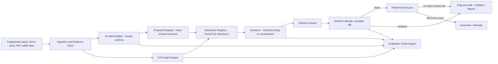

# AegisDAO IntentLock: Final Project Blueprint

**Hackathon:** CASCADE '26 (24-hour build)
**One-liner:** *Votes shouldn't authorize a vibe. They should authorize an exact action.*

**Core value proposition:** AegisDAO connects proposals, evidence, disclosures, voting, and execution into one verifiable decision trail. The human-readable intent a DAO votes on is bound to a cryptographic execution commitment. An on-chain executor refuses anything that deviates from it, and a simulation layer explains every discrepancy in plain English.

---

## 0. How This Maps to the Problem Statement

| Problem statement requirement | AegisDAO component | Section |
| :--- | :--- | :--- |
| Verifiable proposals: versions, financial assumptions, technical assessments, tamper-evident history | Hash-chained **Proposal Registry** + evidence manifest | 3 |
| Decision intelligence: summaries with traceable references | **Source-linked AI Intent Drafting** + treasury impact brief | 6 |
| Conflict-of-interest: forced disclosure, mathematically mapped wallet connections | **Disclosure Registry** + **Disclosed-vs-Discovered Graph** | 5 |
| Execution accountability: compare approved decision vs actual execution | **Execution Commitment** + **Protected Executor** | 4 |
| Live contested upgrade with obfuscated payload: parse, simulate, halt or flag | **Sentinel** (decode, simulate, flag, halt) + **Red-Team Arena** | 7, 8 |
| Probabilistic Evaluation Chain: Claims → COI Risk → Voting → Execution Discrepancy | **Evaluation Chain Engine** | 2 |
| Prevent central authorities controlling information to token holders | Content-addressed evidence, permissionless verification, no admin can edit history | 3, 9 |

---

## 1. System Architecture



**Three enforcement layers, kept deliberately separate:**

| Layer | Role | Trust level |
| :--- | :--- | :--- |
| **Layer 1: Protected Executor (on-chain)** | Hard guarantee. Reverts anything outside the commitment and policy. | Cryptographic and deterministic. This is the security claim. |
| **Layer 2: Sentinel simulation (off-chain)** | Early warning before and during timelock. Can flag and trigger a halt. Produces evidence for the UI. | Deterministic checks, but limited to what simulation can observe. |
| **Layer 3: AI drafting and summaries** | Helps humans understand and write intent. Never approves, never enforces. | Advisory only. A human confirms the output. |

> The LLM is never in the enforcement path. Anything the AI says must be verifiable against evidence, and anything that blocks execution is deterministic code.

---

## 2. Probabilistic Evaluation Chain

The problem statement defines the chain **Proposal Claims → Conflict of Interest Risk → On-Chain Voting → Execution Discrepancy**. AegisDAO exposes it as a single pipeline where each stage produces a score *and* an explanation, and each stage feeds the next.

We do **not** collapse this into one "92% safe" number. The UI shows a per-stage vector, plus carry-forward flags.

### Stage 1: Proposal Claims (Claim Reliability, `C`)

For each extracted claim `i`:

```
c_i = extraction_confidence_i × evidence_support_i
```

- `extraction_confidence_i`: model-reported confidence, penalized if the claim has no source span.
- `evidence_support_i`: 1.0 if the cited span re-hashes to the anchored document and the numbers reconcile, 0.5 if partially supported, 0 if unsupported.
- `UNRESOLVED` claims count as 0 and are surfaced as a list.

`C = mean(c_i)`, reported together with `unresolved_count` and `unsupported_count`.

### Stage 2: Conflict-of-Interest Risk (`R`)

Each discovered wallet link `j` between the proposer (or beneficiary) and a related party gets a link strength `s_j ∈ [0,1]` from transparent heuristics:

| Evidence type | Example `s_j` |
| :--- | :--- |
| Direct transfer between wallets | 0.8 |
| Common funder within N blocks | 0.6 |
| Shared contract deployer or multisig signer | 0.7 |
| Time-correlated transfers with similar amounts | 0.4 |

Risk uses a **noisy-OR** so independent evidence accumulates but never exceeds 1:

```
R_discovered = 1 − Π_j (1 − s_j)
R = R_discovered × (1 + δ·undisclosed_fraction)   capped at 1
```

`undisclosed_fraction` is the share of discovered links the proposer **did not disclose**. Non-disclosure raises risk; disclosed links are shown but weighted lower. Weights are heuristic and labeled as such. Output is "potential conflict, evidence attached," never an accusation.

### Stage 3: On-Chain Voting (Vote Integrity, `V`)

A function of:

- Quorum reached and margin of victory.
- **Informed-vote ratio:** share of voting power cast with a brief acknowledgment (see Informed Voting Mode).
- Voting power concentration (top-N holders' share).
- Overlap between voters and wallets flagged in Stage 2.

Reported as a sub-score with each factor visible.

### Stage 4: Execution Discrepancy (`D`)

This stage is **deterministic, not probabilistic**:

```
D = 0  if executed actions == committed actions AND all policy constraints hold
D = 1  otherwise (blocked or flagged)
```

Where the Sentinel can only simulate (not prove), it reports `simulation_confidence` separately and never overrides the on-chain result.

### Chain composition

```
Claims(C) ──► COI(R) ──► Voting(V) ──► Execution(D)
   │            │           │             │
   └─ unresolved └─ links    └─ informed   └─ HARD GATE: D=1 halts
      claims        w/ txs      ratio          regardless of upstream scores
```

Upstream stages **inform voters**; the final stage **enforces**. A perfect upstream score can never override an execution mismatch. The dashboard shows a **Decision Trail** card with the four stages left to right, each with status (green, amber, red), score, and "why" drilldown.

---

## 3. Verifiable Proposals: Tamper-Evident History

### 3.1 Proposal Registry (hash-chained versions)

Every edit creates a new version. Versions are chained, content-addressed, and append-only.

```solidity
struct Version {
    bytes32 prevVersionHash;         // 0x0 for v1
    bytes32 contentHash;             // hash of the proposal text
    bytes32 evidenceRoot;            // Merkle root of evidence manifest (PDFs, models, audits)
    bytes32 financialAssumptionsHash;
    bytes32 technicalAssessmentHash;
    bytes32 intentHash;              // hash of confirmed structured intent (Section 6)
    bytes32 disclosureHash;          // hash of COI disclosure (Section 5)
    uint64  timestamp;
    address author;
}

versionHash = keccak256(abi.encode(version));
```

Properties:

- Append-only. Nothing can be edited or deleted; amendments are new versions pointing at `prevVersionHash`.
- Anyone can recompute the chain from public data and verify it.
- **Voting binds to one specific `versionHash`.** Any change after voting begins creates a new version and a **new vote** (see 4.3).

### 3.2 Evidence manifest

- Every document (forum post snapshot, the "vague external PDF", financial model, audit) is stored content-addressed (SHA-256/keccak; optional IPFS pin).
- The manifest is a Merkle tree; `evidenceRoot` is anchored on-chain.
- AI claims reference `(docHash, page, span)`. The UI re-hashes the document locally to prove the cited source is the committed one.

---

## 4. Execution Accountability: Commitment and Protected Executor

### 4.1 Cryptographic Execution Commitment

The vote authorizes a commitment to the **complete** execution package, not a summary.

```solidity
bytes32 constant COMMIT_TYPEHASH = keccak256(
  "Commitment(uint256 chainId,address executor,uint256 proposalId,uint256 version,bytes32 versionHash,bytes32 actionsHash,bytes32 intentHash,bytes32 disclosureHash)"
);

function hashActions(Action[] calldata a) internal pure returns (bytes32) {
    bytes32[] memory leaves = new bytes32[](a.length);
    for (uint256 i; i < a.length; ++i) {
        leaves[i] = keccak256(abi.encode(a[i].target, a[i].value, keccak256(a[i].data)));
    }
    return keccak256(abi.encodePacked(leaves));
}

bytes32 commitment = keccak256(abi.encode(
    COMMIT_TYPEHASH,
    block.chainid,        // prevents cross-chain replay
    address(this),        // binds to this executor
    proposalId,
    version,
    versionHash,          // ties to the hash-chained registry entry
    actionsHash,          // exact targets, values, calldata hashes, in order
    intentHash,           // human-confirmed constraints
    disclosureHash        // COI disclosure that voters saw
));
```

Changing the target, value, calldata, intent, disclosure, chain, executor, or version changes the commitment, so execution fails.

### 4.2 Protected Executor: constraint enforcement

The executor does **not** claim universal bytecode safety. It uses a restricted execution model:

- Only `call` is used. **`delegatecall` is never available**, even to the DAO.
- Every action must match a typed **rule** from the committed intent. Unknown selectors are rejected.
- Rules are committed via `intentHash`; the executor requires `keccak256(abi.encode(rules)) == intentHash` before enforcing.

```solidity
enum ActionKind { ERC20_TRANSFER, ERC20_APPROVE, PARAM_SET, UPGRADE, OWNERSHIP_TRANSFER, MULTICALL }

struct ActionRule {
    ActionKind kind;
    address target;          // exact contract allowed
    bytes4  selector;        // exact function allowed
    address counterparty;    // recipient / spender / new owner / approved implementation
    uint256 maxAmount;       // spend or allowance ceiling
    bytes32 codeHash;        // required extcodehash for upgrade targets
    uint8   childCount;      // for MULTICALL: number of nested rules that follow
}
```

**ERC-20 transfer enforcement (corrected, with selector handling):**

```solidity
function _enforceTransfer(bytes calldata data, ActionRule calldata r) internal pure {
    if (data.length != 68) revert BadCalldataLength();
    if (bytes4(data[:4]) != IERC20.transfer.selector) revert SelectorNotAllowed();

    (address to, uint256 amount) = abi.decode(data[4:], (address, uint256));

    if (to != r.counterparty) revert UnauthorizedRecipient(to);
    if (amount > r.maxAmount) revert ExceedsSpendLimit(amount);
}
```

**Approvals:** `approve` is only allowed if the rule names the exact spender and a bounded amount. Unlimited approvals (`type(uint256).max`) are rejected unless explicitly committed.

**Nested calls (`multicall`):** A wrapper action is accepted **only** if the intent contains a `MULTICALL` rule listing child rules. The executor decodes inner calls recursively (depth-limited to 2) and enforces every inner call against its own child rule. A hidden `transferOwnership` inside a `multicall` has no matching rule and reverts the entire execution.

### 4.3 State machine and immutability

```
Draft → DisclosurePending → VotingOpen → Passed → Queued (timelock) → Executed
                                              ↘ Defeated        ↘ Halted / Cancelled
```

- The commitment is **immutable once voting opens**. Any change creates a new version and a new proposal round, and old votes do not carry over.
- On execution, the executor checks that the voted version is still the latest non-superseded version (blocks execution of stale versions).
- Each proposal executes **once** (`state = Executed` is set before external calls: checks-effects-interactions).
- `nonReentrant` guards `execute`, so malicious recipient contracts cannot re-enter.
- Timelock: `block.timestamp >= eta` is required. Early execution reverts.

### 4.4 Privilege escalation and upgrade rules

Rejecting unknown selectors is not enough when a dangerous function is legitimately allowlisted.

- **Upgrades:** an `UPGRADE` rule must name the **exact implementation address** and its **`extcodehash`**. The executor verifies `target.codehash == rule.codeHash` before the call, so swapping the implementation's code after the vote fails.
- **Ownership:** `transferOwnership` / role grants are only allowed if the rule's `counterparty` matches the new owner exactly.
- **Post-conditions** (checked after actions, reverting the whole transaction on failure) where natively verifiable:
  - `owner()` / admin role holders match expectations (committed unless a rule changes them)
  - Token `allowance(treasury, spender)` does not exceed committed ceilings
  - Treasury balance decreased by no more than the sum of committed `maxAmount`s
  - For EIP-1967 proxies behind a ProxyAdmin, implementation equals the committed address

### 4.5 Guardian (halt only)

A guardian (multisig or Sentinel key) can **halt or cancel** a queued proposal during the timelock. It **cannot execute, edit, or substitute** anything. This gives "autonomously halt or flag" without creating a central point of control over outcomes. Halts are logged on-chain with the violation report hash and can be challenged or overridden by a DAO vote.

---

## 5. Conflict-of-Interest: Forced Disclosure and Discovery

### 5.1 Forced disclosure (on-chain)

Voting **cannot open** until the proposer publishes a signed disclosure:

- List of related wallets (self, team, beneficiaries, funders, affiliated multisigs).
- Declared financial interests and relationships (free-text, hashed).
- Optional bond that is returned if no undisclosed link is substantiated.
- `disclosureHash` is part of the version and the commitment, so voters always know which disclosure they voted under.

### 5.2 Discovery graph

A graph engine ingests wallet transaction data and finds relationships between the proposer, the payment recipient, and related parties.

- Nodes: wallets, with labels (proposer, disclosed, recipient, intermediary).
- Edges: transfers with **transaction hash, amount, timestamp, token**.
- Each path found is scored with link strength (Section 2, Stage 2).

### 5.3 Disclosed vs. Discovered (signature view)

| Link | Status | Evidence |
| :--- | :--- | :--- |
| Proposer → Dev wallet | ✅ Disclosed | tx 0x… |
| Proposer → Intermediary → **Recipient** | ⚠️ **Undisclosed (discovered)** | 2 txs, 3 days apart |

- Undisclosed links raise COI risk and trigger a **Disclosure Challenge**: anyone can submit a path with tx proofs during the challenge window. A verified challenge flags the proposal, extends the timelock, and surfaces a warning in the voting UI.
- All labels are cautious: *"potential conflict, supporting transactions attached."* The system never claims corruption.
- For the hackathon, the graph runs on **seeded simulated data**, clearly labeled **SIMULATED DATA** in the UI.

---

## 6. Decision Intelligence: Human-in-the-Loop AI Intent Drafting

The AI **proposes**; humans **confirm**.

1. **Ingest** the forum post, PDF, and linked material.
2. **Extract structured intent** as JSON (schema below). Every claim carries a source reference `(docHash, page, section, span)`.
3. **Mark ambiguity** as `UNRESOLVED`. The proposer and reviewers must resolve or accept each item.
4. **Treasury impact brief:** amounts, recipients, dependencies, runway impact, with each figure linked to its source.
5. **Confirmation:** once the proposer and reviewers sign off, the confirmed structure is hashed to produce `intentHash` and the executor rules.

**Intent specification (example):**

```json
{
  "title": "Q4 Development Grant",
  "actions": [
    {
      "kind": "ERC20_TRANSFER",
      "token": "USDC",
      "recipient": "0xDevWallet...",
      "maxAmount": "5000000000",
      "source": { "docHash": "0xabc...", "page": 3, "section": "2", "span": [120, 188] },
      "confidence": 0.94
    }
  ],
  "unresolved": [
    { "question": "Is the payment one-time or recurring?", "source": { "docHash": "0xabc...", "page": 4 } }
  ],
  "assumptions": [{ "name": "Runway after grant", "value": "18 months", "source": { "docHash": "0xdef...", "page": 1 } }]
}
```

**The jargon problem:** for the obfuscated-payload scenario, the pipeline produces two parallel structured views and diffs them deterministically:

| View | Source | Example |
| :--- | :--- | :--- |
| **Stated intent** | AI-parsed proposal text, human-confirmed | "Routine parameter tuning of fee module" |
| **Actual effect** | Deterministic calldata decoder and simulation | "Upgrades treasury proxy to 0xBAD…; transfers ownership to 0xATTACKER" |

The diff, not the AI's opinion, drives the flag.

---

## 7. Sentinel: Decode, Simulate, Flag, Halt

The Sentinel is an off-chain service (TypeScript + Hardhat) that watches queued proposals during the timelock. It is the early-warning layer; the executor remains the hard guarantee.

### 7.1 Pipeline

1. **Decode:** local ABI registry, selector decoding, recursive `multicall` unwrapping. Output is human-readable ("Calls `upgradeTo(0xBAD…)` on TreasuryProxy").
2. **Static checks:** scan any proposed implementation or target bytecode for `DELEGATECALL`, `SELFDESTRUCT`, `CALLCODE`; compare `extcodehash` against committed hash.
3. **Sandbox simulation:**
   1. `evm_snapshot` on a local Hardhat node (forked state where available).
   2. Send the exact proposed transaction against the sandbox. (Use a real transaction rather than `eth_call` so state changes can be traced.)
   3. `debug_traceTransaction` with `callTracer` to capture the call tree, delegatecalls, and nested calls; read event logs and storage changes.
   4. Diff balances, ownership, allowances, implementation slot, and role holders before vs. after.
   5. `evm_revert` to restore state.
4. **Compare** results against the committed intent and explicit invariants.
5. **Output:** a structured **Violation Report**, and (on violation) a signed `halt(proposalId, reportHash)` call from the guardian key.

### 7.2 Simulation vs. executor reverts (never conflated)

| | Sentinel simulation | Protected Executor |
| :--- | :--- | :--- |
| Where | Off-chain sandbox | On-chain |
| Purpose | Early warning, evidence, explanation | Hard prevention |
| Guarantee | Detects what it can observe | Reverts violations of the commitment and policy |
| UI label | "Simulation detected…" | "Rejected by executor…" |

If time pressure hits, the fallback is a fork-based simulation comparing balance, ownership, and storage diffs, skipping full trace parsing. The executor's on-chain checks do not depend on the Sentinel.

### 7.3 Red-Team environment

A `VulnerableProxy.sol` with a documented storage layout is used locally to demonstrate simulation-based detection of storage-level changes. The production executor does not depend on it.

---

## 8. Red-Team Arena

A one-click arena that runs reproducible attacks against the protected executor and shows pass/fail with evidence. Each scenario is a Hardhat test **and** a button in the UI.

| # | Scenario | Attack | Expected result | Blocked by |
| :--- | :--- | :--- | :--- | :--- |
| 0 | **Benign transfer** | Transfer 5,000 USDC to the approved dev wallet | ✅ **Succeeds** | n/a |
| 1 | **Post-vote payload substitution** | Recipient swapped after the vote | ❌ Reverts | Commitment mismatch |
| 2 | **Amount inflation** | Same recipient, 50,000 instead of 5,000 | ❌ Reverts | Commitment mismatch + spend limit |
| 3 | **Jargon upgrade** | Proposal says "routine parameter tuning"; calldata calls `upgradeTo(maliciousImpl)` | ❌ Reverts / Sentinel flags | No matching rule; code hash not approved |
| 4 | **Nested multicall** | `multicall([setFee, transferOwnership])` | ❌ Reverts | Recursive rule enforcement |
| 5 | **Unlimited approve** | `approve(attacker, type(uint256).max)` disguised as a payment | ❌ Reverts | Approve rule bounds |
| 6 | **Delegatecall payload** | Payload routed via delegatecall to a malicious contract | ❌ Not executable | Executor has no delegatecall path; Sentinel flags in trace |
| 7 | **Re-entrancy** | Recipient contract re-enters `execute` | ❌ Reverts | `nonReentrant` + state set before call |
| 8 | **Early execution / replay** | Execute before `eta`; execute twice; replay on another chain | ❌ Reverts | Timelock, executed flag, `chainid` in commitment |
| 9 | **Stale version** | Execute v1 after v2 supersedes it | ❌ Reverts | Version check against registry |
| 10 | **Hidden conflict** | Proposer funds recipient through an intermediary and omits it from disclosure | ⚠️ Flagged | Disclosure Challenge + COI graph |

**Required minimum for demo:** scenario 0 passes; scenarios 1, 3, 4, 5 are blocked live; scenario 10 shows the flag.

---

## 9. UI Signature Features

### 9.1 Decision Trail (the evaluation chain)

A horizontal pipeline: **Claims → COI Risk → Voting → Execution**. Each card shows status, score, a one-line reason, and a "view evidence" drilldown. This is the first screen judges see.

### 9.2 Intent Violation Explainer

Every rejection or flag generates a structured report:

> **IntentLock · Security Report**
> *Rejected by executor | Scenario: Jargon upgrade*
> - **Proposal said:** "Routine parameter tuning of the fee module."
> - **Approved execution:** Set `feeBps` on FeeModule to a value ≤ 50.
> - **Submitted execution:** `upgradeTo(0xBAD…)` on TreasuryProxy, then `transferOwnership(0xATTACKER)`.
> - **Violated constraint:** No approved rule permits an upgrade; implementation code hash is not in the committed intent.
> - **Verifiable evidence:** [Approved commitment] · [Submitted calldata + decode] · [Revert receipt or simulation trace]

The decode is shown side-by-side with the original jargon so any voter can see the gap.

### 9.3 Governance Security Scorecard

Generated from the **actual test run output** (JSON from Hardhat), not hardcoded:

| Property | Status |
| :--- | :--- |
| Approved transfer succeeds | ✅ PASS |
| Unauthorized recipient rejected | ✅ PASS |
| Post-vote payload substitution rejected | ✅ PASS |
| Unauthorized upgrade rejected | ✅ PASS |
| Hidden ownership transfer in multicall rejected | ✅ PASS |
| Unlimited approval rejected | ✅ PASS |
| Re-entrancy rejected | ✅ PASS |
| Stale version rejected | ✅ PASS |

Any property without a passing test shows as ⚠️ **TEST REQUIRED**, never as a pass.

### 9.4 Provenance-Aware Wallet Graph

Disclosed vs. discovered links, with transaction hashes, amounts, and timestamps. Labeled **SIMULATED DATA** and **potential issue, not corruption**.

### 9.5 Informed Voting Mode

- **Risk brief:** one page with the Evaluation Chain, unresolved items, COI findings, and treasury impact.
- **Acknowledged voting:** voters can cast `voteWithBrief(proposalId, support, briefHash)`, recording which brief version they saw. This feeds the informed-vote ratio in Stage 3.
- **Attention queue:** ranks active proposals by risk (undisclosed links, unresolved claims, large treasury impact) so voters see what needs scrutiny first.

---

## 10. Tech Stack and Repo Layout

| Area | Choice |
| :--- | :--- |
| Contracts | Solidity ^0.8.24, OpenZeppelin (ReentrancyGuard, IERC20) |
| Testing and simulation | Hardhat, TypeScript, ethers v6, Hardhat network RPCs (`evm_snapshot`, `evm_revert`, `debug_traceTransaction`) |
| Sentinel | Node/TypeScript service |
| AI | LLM API with strict JSON schema output; source spans required |
| Evidence store | Content-addressed local store with optional IPFS pin |
| Frontend | React / Next.js + Tailwind, graph via a force-directed library |
| Data | Seeded JSON scenarios for wallets, proposals, and evidence |

```
aegisdao/
├── contracts/
│   ├── ProposalRegistry.sol
│   ├── DisclosureRegistry.sol
│   ├── IntentGovernor.sol
│   ├── IntentLockExecutor.sol
│   ├── libs/ActionDecoder.sol
│   └── test-helpers/ (MockUSDC, VulnerableProxy, MaliciousImpl, ReentrantRecipient)
├── test/
│   ├── commitment.test.ts
│   ├── executor.test.ts
│   └── redteam/ (one file per attack scenario)
├── sentinel/
│   ├── decode.ts
│   ├── simulate.ts
│   ├── diff.ts
│   └── report.ts
├── ai/
│   ├── extract.ts          # structured intent + source spans
│   └── schema.json
├── graph/
│   ├── seed-data.json
│   └── score.ts            # link strength + noisy-OR
├── app/                    # frontend
└── README.md
```

---

## 11. Build Order (dependency-driven)

Contracts and tests come first because every other layer depends on them. Work can be parallelized across the streams below once the interfaces are fixed.

1. **Contracts core:** `ProposalRegistry`, commitment hashing, `IntentLockExecutor` with rules, timelock, reentrancy guard.
2. **Test suite:** benign path first, then every Red-Team scenario. The scorecard is generated from these results.
3. **Disclosure + Governor:** forced disclosure, voting on commitments, `voteWithBrief`.
4. **Sentinel:** decoder, simulation, diff, report generator, guardian halt.
5. **AI drafting:** structured extraction with source spans (pre-bake outputs for the demo as a fallback).
6. **Graph + Evaluation Chain:** seeded data, scoring, Decision Trail.
7. **Frontend:** Decision Trail, Violation Explainer, Scorecard, Graph, Informed Voting.
8. **Demo polish:** scripted flow, fallbacks, README.

**Parallel streams:** (A) contracts and tests, (B) Sentinel, (C) AI + graph + chain scoring, (D) frontend, integrating against the fixed report and scorecard JSON schemas.

---

## 12. Demo Script

1. **Setup:** a DAO forum post with a vague external PDF proposes a treasury action.
2. **AI draft:** structured intent appears with source-linked claims and `UNRESOLVED` flags. Proposer and reviewer confirm. Version hash chain shown.
3. **Disclosure:** proposer submits wallet disclosure. Graph shows an **undisclosed link** surfaced from simulated data; COI risk rises.
4. **Informed vote:** voters see the risk brief and vote with acknowledgment. Decision Trail shows Claims, COI, and Voting stages.
5. **Attack:** an attacker queues a payload described as "routine parameter tuning" that contains a hidden upgrade and ownership transfer inside a `multicall`.
6. **Sentinel:** decodes and simulates the payload, flags the discrepancy, and the guardian halts the proposal.
7. **Executor:** even if executed directly, the transaction **reverts on-chain**. The Violation Report shows the jargon beside the real decode with evidence links.
8. **Contrast:** the benign 5,000 USDC transfer to the approved wallet executes successfully.
9. **Scorecard:** run the Red-Team Arena live; the scorecard populates from real test results.

**Closing line:** *"Voting transparency isn't informed consent. We made the vote bind to the exact action, and we make the evidence, the conflicts, and the execution verifiable."*

---

## 13. Honest Limitations

Stating these openly is part of the pitch.

- The executor enforces a **restricted action model** (typed rules). It does not claim to prove arbitrary bytecode safe.
- Simulation detects what it can observe; it is an early-warning layer, not the security guarantee.
- Conflict-of-interest scores use **transparent heuristics**, not ground truth. Links are *potential* conflicts, with evidence.
- AI output is advisory, source-linked, and human-confirmed. It is never in the enforcement path.
- Wallet graph data in the demo is **simulated**.
- The guardian can only halt, not execute; halts are on-chain, logged, and challengeable by the DAO.
- Post-condition checks cover natively verifiable invariants (ownership, allowances, balances, proxy implementation); not every storage invariant is checkable.

---

## 14. Definition of Done

- [ ] Changing target, value, calldata, intent, disclosure, version, chain, or executor invalidates execution (unit tests).
- [ ] Benign transfer succeeds; scenarios 1 to 9 revert as specified.
- [ ] Hash-chained version history verifiable from public data.
- [ ] Voting cannot open without a disclosure; challenge flow flags a proposal.
- [ ] Sentinel produces a Violation Report with decoded actual-vs-stated comparison and can halt.
- [ ] AI draft includes source-linked claims and unresolved ambiguities; human confirmation produces `intentHash`.
- [ ] Decision Trail shows Claims → COI → Voting → Execution with per-stage reasons.
- [ ] Scorecard is generated from real test output.
- [ ] Demo runs end-to-end, with pre-baked fallbacks for AI and graph data.
