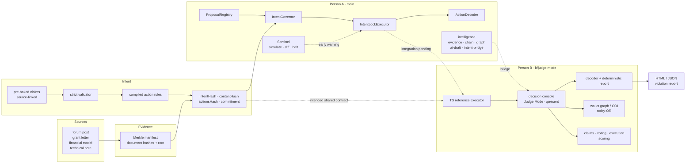

# AegisDAO IntentLock — whole-project map

> A visual atlas of the **whole system**, not the product website.  
> Snapshot: **2026-10-25** · `main` = `55c636a` (chain + intelligence) · `b/judge-mode` = `ea78e84` (judge experience).

**Open the visual atlas:** [PROJECT-ATLAS.html](PROJECT-ATLAS.html) · [source pack](atlas/README.md)

---

## 0. How to read this

1. **Start with the truth banner** below: there are two complete halves and no merge.
2. **Follow the system map** once: sources → evidence → intent → commitment → governor → executor → decode/report → console.
3. **Use the collision table** before assuming any A/B piece plugs into the other.
4. **Read the Decision Trail and the artifact** for the product story.
5. **Open the demo path** only after the architecture is clear. The standalone [PROJECT-ATLAS.html](PROJECT-ATLAS.html) is the visual version of this document.

---

## 1. The 60-second version

A DAO proposal passes, but the transaction that would execute does something else.

Binding a vote to calldata is **not new** — Compound and OpenZeppelin Governors derive the proposal id from the encoded calls. The failure is elsewhere: the description is not reconciled with the code, the evidence behind the proposal is not committed, conflicts are not disclosed, and the code at an approved address can change after approval.

IntentLock adds the missing layer. The demo proposal, **AIP-042**, authorizes two transfers and a bounded allowance; the queued call is an uncommitted `upgradeTo(maliciousImpl)` on the treasury proxy.

Three promises:

1. **Commit the evidence and the disclosure, not just the calldata** — one commitment over rules, calldata, evidence root, disclosure and version.
2. **Make the description/calldata gap and the conflicts legible** — source-linked claims, validator, decoder, deterministic report, disclosed-vs-discovered wallet graph.
3. **Refuse uncommitted shapes and verify code identity at execution** — no hidden multicall child, no unapproved upgrade, no stale version, no code swapped after approval.

The closing line remains: *“Voting transparency isn’t informed consent. We made the vote bind to the exact action, and we make the evidence, the conflicts, and the execution verifiable.”* The binding is table stakes; the comprehension, evidence, conflicts, and execution identity are the product.

### Why this is not just another Governor

| System | It already has | It leaves open |
| :--- | :--- | :--- |
| Compound / OZ Governor | proposal id = hash of calls | description is a separate string; no evidence/disclosure commitment |
| Tally / Tenderly / OZ Defender | decoding, simulation, state diffs | advisory display; not consulted by the executor |
| Zodiac Roles | standing calldata permissions | policy, not a per-proposal commitment |
| **IntentLock** | per-proposal commitment + refusal semantics | evidence and disclosure are in the commitment; the report makes the gap legible |

### Limits to state out loud

- A vote that honestly authorizes something bad still executes; we bind intent to action, not judgment.
- A self-authored, internally consistent evidence set gets a valid Merkle root; the root proves integrity, not truth.
- A compromised governor or executor invalidates the guarantee.
- The informed-vote receipt raises the cost of voting blind; it does not prevent a delegate voting against their mandate.

See the fuller positioning and prior art in [person-a-direction.md](person-a-direction.md).

---

## 2. The important truth: two complete halves, one unmerged project

The public repository has two **unrelated histories**:

| Half | Branch | Commit | What is there |
| :--- | :--- | :--- | :--- |
| Chain + intelligence | `main` | `55c636a` | Solidity contracts, Hardhat tests, Sentinel, deployments, `intelligence/` modules, a chain-side console prototype |
| Judge experience | `b/judge-mode` | `ea78e84` | Next.js decision console, evidence/AI/hash pipeline, arena, scorecard, Judge Mode, `/present`, HTML/JSON report export |

Both halves also contain a console under `app/`:

| Surface | Branch | Runtime | Purpose |
| :--- | :--- | :--- | :--- |
| Chain-side console | `main` | Hardhat runner + `intelligence/` + contracts | Prove the arena and execution logic end-to-end |
| Judge-facing console | `b/judge-mode` | Next.js + TypeScript reference executor | Explain and verify the decision trail for judges |
| Archipelago visual site | local `main` only | static visual experiment | Intentionally out of scope for this atlas |

There is **no common ancestor**, and the two trees are **not merged**. The B app currently computes verdicts with a **TypeScript reference executor**; A's Solidity executor is not wired into it. The B scorecard correctly keeps its nine on-chain properties `TEST_REQUIRED` until that integration happens. A's branch carries a checked-in red-team scorecard (`11/11 PASS`) and 44 intelligence unit tests; those were not rerun in this B workspace.

The local working copy also has a newer `main` with a separate visual-site experiment. That site is intentionally **out of scope** here.

### Known merge collisions (verified in the source docs)

| Boundary | A (`main`) | B (`b/judge-mode`) | Consequence |
| :--- | :--- | :--- | :--- |
| Commitment hash | `COMMIT_TYPEHASH` + version hash, ethers | custom `(chain, executor, proposalKey, version, actions, intentHash, evidenceRoot, disclosure)` | A/B commitments are not interchangeable |
| Error map | 43 selectors across four contracts | 17 `ERROR_DEFINITIONS` | Only a few names/selectors overlap; the report mapping is not portable |
| Executor ABI | `execute(..., (address,uint,bytes)[], Rule[])` | `execute(uint256,uint256,bytes[])` | An adapter is required before the console can call the contract |
| Addresses | Fixed Hardhat deployments | Deterministic fixture addresses | Commitments and labels differ |
| Scorecards | 11 red-team rows, all PASS | 34 rows: 25 PASS / 9 TEST_REQUIRED | Merging either file blindly flips the honesty ledger |
| Hash implementation | `packages/shared/hash.ts`, ethers | Same path, `viem` | One path, two incompatible schemes |
| `app/` | Chain-side console + Hardhat backend | Judge-facing console + reference executor | Both claim the same path; a merge must choose one shell or compose them |
| Multicall call shape | `multicall(bytes[])`, selector `0xac9650d8` | custom `multicall((address,bytes)[])`, selector `0xcaa5c23f` | Encoded bundles are not interchangeable |
| Graph/scoring constants | disclosed ×0.15, undisclosed ×1.2; harmonic voting | disclosed ×0.35, undisclosed ×1.0; B's own formulas | The same graph produces different scores in each half |
| Intelligence bridge | `intent-bridge.ts` has an `intentHash` scheme mismatch and empty multicall bytes | reference executor matches B's own scheme | Bridge needs correction, not just wiring |

These are not cosmetic. The atlas and the source docs surface them because a document that hides them would be misleading.

---

## 3. System map



`main` contains the contracts and the intelligence bridge; `b/judge-mode` contains the judge-facing experience and the reference executor. The dotted line is the work still to merge.

---

## 4. Layer map

| Layer | Owns | Key pieces | Status |
| :--- | :--- | :--- | :--- |
| **Evidence** | Content-addressed documents, Merkle root and proofs | `evidence/`, `packages/shared/evidence.ts` | Real code over authored seed documents |
| **Intent** | Source-linked claims, validator, reviewer resolutions, rule compilation | `ai/`, `app/intent/`, `packages/shared/hash.ts` | Real code; extraction is pre-baked |
| **Commitment** | Rules + calldata + evidence root + disclosure + version | `packages/shared/hash.ts` | Real TypeScript; Solidity parity is not merged into the app |
| **Chain** | Registries, governor, executor, decoder lib, Sentinel | `contracts/`, `test/`, `sentinel/` on `main` | Contracts + tests present on A's branch |
| **Intelligence bridge** | Evidence/chain/graph/AI-to-UI adapters | `intelligence/` on `main` (44 unit tests) | Present on `main`; not merged into B |
| **Experience** | Decision Trail, intent review, graph, vote, arena, report, Judge Mode, deck | `app/`, `components/`, `lib/demo.ts` | Working B app with 57 tests |
| **Scoring** | Claims, COI, voting, execution gate | `chain-scoring/score.ts` | Real formulas over fixtures |
| **Report** | Decode → deterministic artifact | `sentinel/decode.ts`, `sentinel/report.ts`, `lib/report-export.ts` | Real; HTML + JSON export |

---

## 5. The Decision Trail

| Stage | Question | Current value | Nature |
| :--- | :--- | :--- | :--- |
| **Claims** | Is it sourced? | `0.81` GREEN | Advisory |
| **COI** | Who benefits? | `0.88` RED | Advisory risk (higher is worse) |
| **Voting** | Was the vote informed? | `0.71` AMBER | Advisory |
| **Execution** | Does the calldata match? | `REJECTED — SelectorNotAuthorized` | **Hard gate** (no score) |

The pipeline is **not** an average. A failing executor cannot be offset by a good claims or voting score.

---

## 6. The artifact

The violation report is the product's takeaway:

```
Proposal said:  "…align the treasury implementation with the delivery roadmap…"
Actually does:  upgradeTo(0xf7A1…2337) on TreasuryProxy
Constraint:     SelectorNotAuthorized (0x1420732b)
Evidence:       approved vs submitted commitment · calldata hash
                revert data · deterministic simulated tx hash
```

It can be downloaded as a self-contained **HTML** document or **JSON** bundle from any report page, and from the final presentation slide.

---

## 7. Attack map

| # | Scenario | Layer | Expected on B |
| :--- | :--- | :--- | :--- |
| 0 | Benign grant disbursement | executor | `PASSED` |
| 1 | Recipient substitution | executor | `REJECTED · UnauthorizedRecipient` |
| 2 | Amount inflation | executor | `REJECTED · ExceedsSpendLimit` |
| 3 | Jargon upgrade | executor | `REJECTED · SelectorNotAuthorized` |
| 4 | Nested ownership in multicall | executor | `REJECTED · NestedCallNotAuthorized` |
| 5 | Unlimited approve | executor | `REJECTED · ExceedsAllowance` |
| 6 | Delegatecall payload | sentinel | `FLAGGED · DelegatecallDetected` |
| 7 | Re-entrancy | executor | `REJECTED · ReentrancyDetected` |
| 8 | Early execution / replay | executor | `REJECTED · TimelockNotElapsed` |
| 9 | Stale version | executor | `REJECTED · StaleVersion` |
| 10 | Undisclosed COI | disclosure | `FLAGGED · UndisclosedLink` |

The executor model says what would be rejected; the Sentinel flag says what simulation noticed; the disclosure flag says what the graph found. They are different claims and are labelled as such.

---

## 8. Status board

| Evidence | Count | How verified |
| :--- | ---: | :--- |
| B Vitest suite | **57 tests / 9 files** | Ran in this workspace |
| B scorecard | **25 PASS · 0 FAIL · 9 TEST_REQUIRED** | Generated by `npm run scorecard` |
| B red-team scenarios | **11/11 match expected** | Reference executor |
| A checked-in red-team scorecard | **11/11 PASS** (S0–S10) | Checked-in artifact on `main`; not rerun here |
| A intelligence unit tests | **44** `it()` blocks | Checked-in source on `main`; not rerun here |
| A test files | **15 total** — 14 Hardhat (parity + 11 scenarios + Sentinel + helpers) + 1 intelligence file | Present on `main` |
| Solidity → TS hash parity in the B app | **TEST_REQUIRED** | Not merged/wired |
| Live end-to-end chain integration | **Pending** | The two histories are unmerged |

Use the label that matches the evidence. Do not call a checked-in artifact “a live run,” and do not call the reference executor “on-chain.”

---

## 9. Demo path (B branch)

1. `/` — the verdict and four-stage Decision Trail.
2. `/intent` — resolve two ambiguities; watch the intent/content/commitment hashes match.
3. `/graph` — the undisclosed funding path and challenge payload.
4. `/vote` — read the brief, cast an informed vote, get the receipt.
5. `/arena` — run benign 00 and attack 03.
6. `/arena/03-jargon-upgrade` — jargon beside calldata; download the report.
7. `/scorecard` — the nine amber gaps.
8. `/present` — seven-slide close; Judge Mode in the header follows the same path with Next/Back and `Alt+←/→`.

---

## 10. Read next

- **Visual atlas:** [PROJECT-ATLAS.html](PROJECT-ATLAS.html)
- **Chain + intelligence source doc:** [01-chain-intelligence.md](atlas/01-chain-intelligence.md)
- **Experience source doc:** [02-experience-layer.md](atlas/02-experience-layer.md)
- **B run/demo:** [README.md](../README.md), [demo script](demo-script.md), [Person A handoff](person-a-handoff.md)
- **A chain layer:** `contracts/`, `test/`, `sentinel/`, `intelligence/` on `main`
- **Positioning / prior art:** [person-a-direction.md](person-a-direction.md)

### Source-of-truth rule

If this map and the code disagree, trust the code and update the map. The branch snapshots above are the boundary.


---

## 11. Glossary

| Term | Meaning |
| :--- | :--- |
| **Intent** | The machine-readable rule set the reviewer confirms: actions, sources, assumptions. |
| **Commitment** | The hash the vote binds to: chain, executor, proposal key, version, actions, intent, evidence root, disclosure. |
| **intentHash** | Hash of the compiled action rules. Sources and confidence do not enter it. |
| **contentHash** | Hash of the proposal content: rules + reviewer assumptions + title/version. |
| **Evidence root** | Merkle root over the content-addressed source documents. |
| **Disclosure hash** | Commitment to the proposer's signed wallet disclosure. |
| **Noisy-OR** | `R = 1 − Π(1 − sⱼ)`; independent conflict links combine into one risk score. |
| **Reference executor** | The TypeScript model in B that applies the rules; it is not the deployed Solidity executor. |
| **Hard gate** | Execution is binary (`PASSED` vs rejected/flagged); it is never averaged with advisory scores. |
| **TEST_REQUIRED** | A property that cannot be honestly proven in the current workspace; shown amber, never green. |
| **Sentinel** | Simulation and diff early warning; it is not the enforcement boundary. |
| **Chain-side console** | A's `app/` prototype driven by the Hardhat runner and intelligence modules on `main`. |
| **Judge-facing console** | B's Next.js app on `b/judge-mode`, including Judge Mode, `/present`, and report export. |

---

*If this map and the code disagree, trust the code and update the map. The branch snapshots above are the boundary.*
