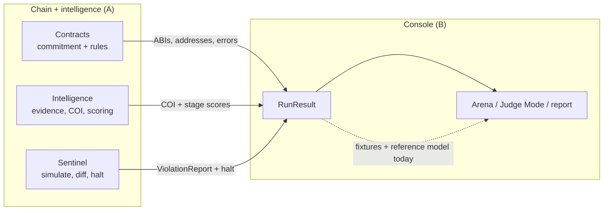
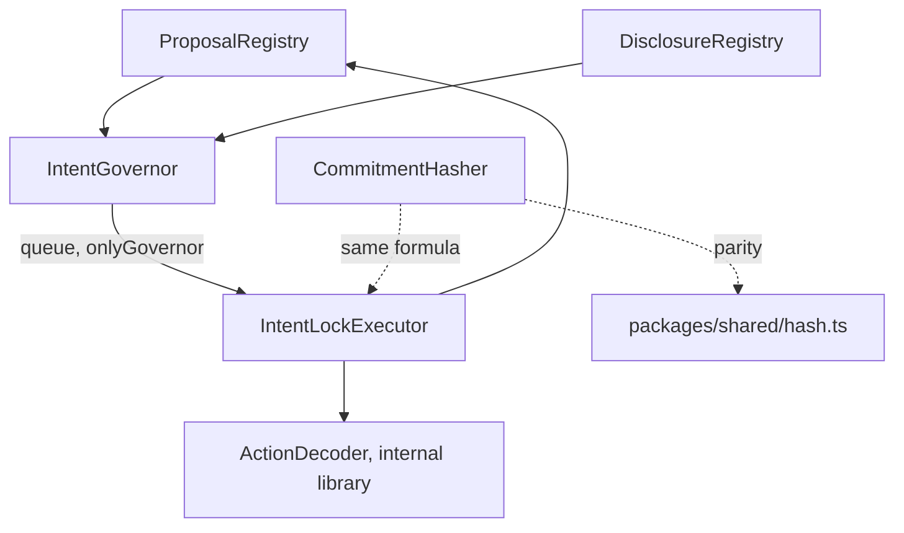
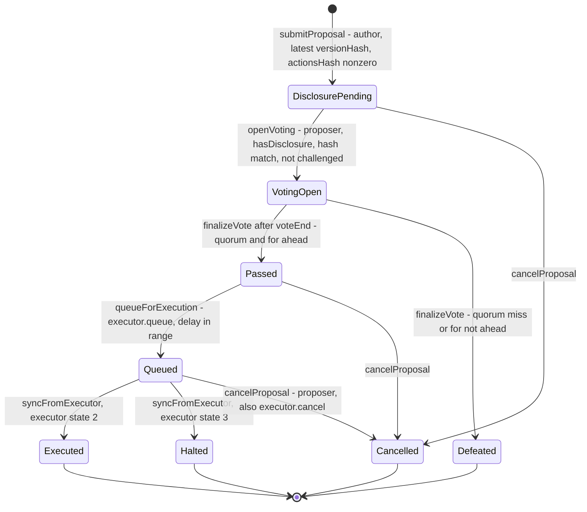
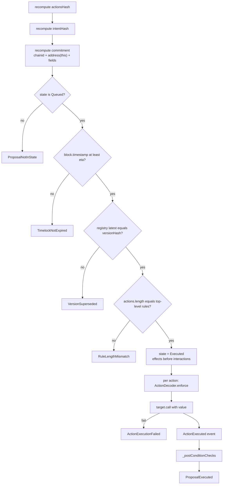
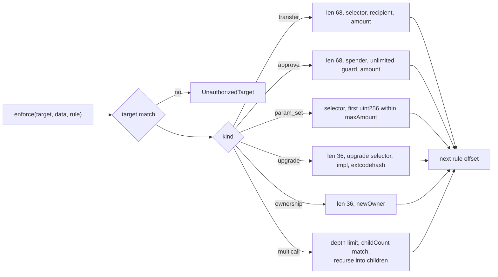
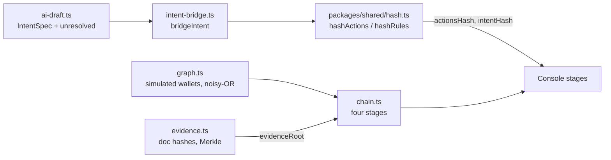
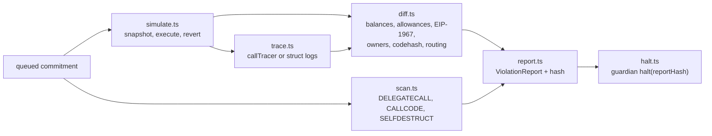
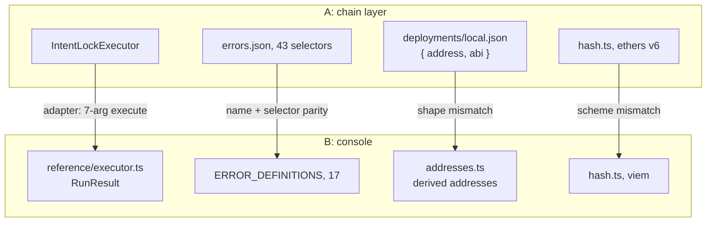

# 01 — Chain + Intelligence Layer

Source document for the project atlas. Scope: Person A's contracts, decoder, intelligence modules and Sentinel. Person B's console appears only at the boundary.

**Legend** — **CODE** in source / **ARTIFACT** backed by a checked-in artifact, not re-run here / **PROTO** prototype or reference model / **PENDING** specified, not integrated.

Paths are relative to `D:\TANTRAFEST-A` unless prefixed `B:`. No Hardhat or ts-mocha run was performed; neither worktree has `node_modules/` or `artifacts/`.

---

## 1. Layer thesis

The chain layer guarantees **byte-level binding**: vote, disclosure, version and exact calldata collapse into one commitment, and the executor refuses anything that recomputes differently. It does not guarantee that the proposal *describes* those bytes honestly — that is the intelligence layer's job, and it is advisory.

**CODE** guarantees: one commitment covers chain id, executor, proposal id, version, version hash, `actionsHash`, `intentHash`, `disclosureHash`; voting cannot open without an unchallenged disclosure; a superseded version cannot execute; only `call` exists, never `delegatecall`; guardian may halt but never execute or edit; timelock and single-execution are enforced by state.

**Not guaranteed:** claim↔rule coherence; that off-chain evidence is what was hashed; a native-value ceiling; a balance-drain post-condition; historical vote weights; governor↔executor sync.



---

## 2. Contract map

| Contract | Key checks | Tested in |
| :-- | :-- | :-- |
| `ProposalRegistry.sol` | author-only `addVersion`; `prevVersionHash`; `verifyChain` recomputes hashes | `scenario9-stale-version.test.ts` |
| `DisclosureRegistry.sol` | nonce, `ecrecover == proposer`, window bounds, verifier-only verify, slash/return | `scenario10-hidden-coi.test.ts` |
| `IntentGovernor.sol` | latest-version equality, disclosure hash match, not challenged, quorum, for>against | `proposeAndQueue` in `test/redteam/fixture.ts`; S10 |
| `IntentLockExecutor.sol` | state, timelock, commitment, supersession, rule count, enforcement, allowance check | `scenario0`–`scenario9` |
| `libs/ActionDecoder.sol` | six kinds, exact matching, recursive multicall | S1–S6, S9 |
| `CommitmentHasher.sol` | pure reference hasher; byte equality with TS | `test/commitment-parity.test.ts` |
| `test-helpers/*.sol` | `MockUSDC`, `FeeModule`, `TreasuryProxy`, `VulnerableProxy`, `MaliciousImpl`, `ReentrantRecipient`; EIP-1967 slots, 10% fee bound | `test/test-helpers.test.ts` |



`ActionDecoder` is `internal`, so it has no address; `deployments/local.json` lists only deployed contracts as `{ address, abi }`.

---

## 3. Governor state machine

`enum GovProposalState`: `Draft 0`, `DisclosurePending 1`, `VotingOpen 2`, `Defeated 3`, `Passed 4`, `Queued 5`, `Executed 6`, `Halted 7`, `Cancelled 8`. `Draft` is never assigned — `submitProposal` writes `DisclosurePending` directly, so a "draft" is only a registry proposal with no `govId`.



- **CODE** `openVoting` records `snapshotBlock`, but `_castVote` weighs with `votingToken.balanceOf(msg.sender)` *now*; the snapshot is unused (the comment admits it).
- **CODE** `finalizeVote` is permissionless, reverts only while `block.timestamp <= voteEnd`, and `forVotes <= againstVotes` defeats, so a tie loses.
- **CODE** `syncFromExecutor` is a manual pull nothing calls, so the governor can stay `Queued` while the executor is `Executed`/`Halted` — the one visible state divergence.
- **PENDING** no test exercises `castVote`, `Defeated`, `syncFromExecutor`, `cancelProposal` or `returnBond`.

---

## 4. Executor check pipeline

`IntentLockExecutor.execute(proposalId, version, versionHash, disclosureHash, actions, rules)`:



| Check | Mechanism | Honest note |
| :-- | :-- | :-- |
| Commitment | recompute, then `proposals[commitment]` lookup | mismatch surfaces as `ProposalNotInState(Queued, Empty)`, not `CommitmentMismatch` |
| Version / chain | `registry.latestVersionHash`; `block.chainid` in the hash | no `WrongChain` error; cross-chain replay just fails the lookup |
| Timelock / executed | `block.timestamp < prop.eta`; state written before external calls | `eta` from a `delay` in `[minDelay, maxDelay]`; a second call sees `Executed` |
| Native value | **no per-action check** | `value` is bound in `actionsHash`; `receive()` accepts ETH; nothing caps it |
| Rules / multicall / reentrancy | `ActionDecoder.enforce`, depth below 2, `ReentrancyGuard` | child rules are contiguous; the test asserts `ActionExecutionFailed` wrapping the guard revert |
| Post-conditions | `_postConditionChecks` | **only** the `ERC20_APPROVE` allowance ceiling; the balance-decrease check in the comment is not implemented |

---

## 5. Action model / decoder

`ActionKind`: `ERC20_TRANSFER 0`, `ERC20_APPROVE 1`, `PARAM_SET 2`, `UPGRADE 3`, `OWNERSHIP_TRANSFER 4`, `MULTICALL 5`. Every action first requires `target == rule.target`. Selectors: transfer `0xa9059cbb`, approve `0x095ea7b3`, upgradeTo `0x3659cfe6`, upgradeToAndCall `0x4f1ef286`, transferOwnership `0xf2fde38b`, multicall `0xac9650d8` (`multicall(bytes[])`).



Stable errors (`contracts/libs/ActionDecoder.sol`; selectors as published in `packages/shared/errors.json`):

```text
BadCalldataLength(uint256,uint256)          0xd8bac5fd
SelectorNotAllowed(bytes4,bytes4)           0xd14e796d
UnauthorizedRecipient(address,address)      0xebe8452a
ExceedsSpendLimit(uint256,uint256)          0xe74fc12b
UnlimitedApprovalNotCommitted(address)      0xad22da11
UnauthorizedImplementation(address,address) 0xf03648bf
CodeHashMismatch(bytes32,bytes32)           0x40de92e3
UnauthorizedNewOwner(address,address)       0xa61746f4
MulticallChildCountMismatch(uint8,uint256)  0x6186a4ee
MulticallDepthExceeded(uint256)             0x4e0ee736
UnauthorizedTarget(address,address)         0x52cea817
UnknownActionKind(uint8)                    0x047d18b2
```

Matching is exact, not semantic: `_enforceParamSet` checks only the selector and the first `uint256`; `_enforceUpgrade` also pins the implementation and optional `extcodehash`, so bytecode swapped after the vote reverts; a hidden `transferOwnership` inside a multicall fails with `SelectorNotAllowed`.

---

## 6. Intelligence bridge



- **CODE** `evidence.ts` — content-addressed store, sorted-pair Merkle (`keccak256(concat(min,max))`), proofs, and `verifySource` which re-hashes the file and bounds the span; an empty tree returns `ZeroHash`.
- **CODE** `chain.ts` — four sequential stages, thresholds in one `CONFIG`; missing input yields `UNKNOWN`, never `PASS`. EXECUTION is a hard gate: `REVERTED|FLAGGED|HALTED` → RED, `PENDING` + Sentinel violation → RED, `NOT_SUBMITTED` → UNKNOWN. Claims = mean(confidence × support); COI = noisy-OR × undisclosed penalty; voting = harmonic mean of quorum signal, informed ratio, `1 − HHI`, COI overlap.
- **CODE + simulated** `graph.ts` — fabricated wallets, four link types, `R = 1 − Π(1 − s_j)`, disclosed links × `0.15`, undisclosed × `1.2`, plus a `challengePayload` hashed from canonical evidence.
- **CODE** `ai-draft.ts` — `IntentSpec` extraction, heuristic and LLM paths; ambiguous items stay in `unresolved[]`.
- **CODE, with a real gap** `intent-bridge.ts` — refuses to bridge while `unresolved[]` is non-empty (`BridgeError`), encodes calldata per kind, hashes only via `packages/shared/hash.ts`. But it sets `intentHash = keccak256(canonical JSON)` where the executor uses `keccak256(abi.encode(rules))`, and `MULTICALL` encodes an **empty** inner `bytes[]` while reporting `childCount = children.length` — a bridged multicall would not match an on-chain rule set.

Unit tests: **44 `it()` cases in one file**, `intelligence/__tests__/intelligence.test.ts`, in 8 `describe` blocks (Merkle 7, store 8, claims 4, COI 4, voting 3, execution 7, end-to-end 3, bridge 8). Counted, not executed.

---

## 7. Sentinel



- **CODE** `simulate.ts` scans candidate code, snapshots state, executes through the real executor with an explicit gas limit, captures pre/post state, diffs, then reverts.
- **CODE** `diff.ts` treats EIP-1967 impl/admin slots and the documented `VulnerableProxy` slots 0/1 as critical, then checks allowance growth, per-token drain against summed `maxAmount`, extcodehash stability, and trace-level routing. `halt.ts` hashes the report and calls `executor.halt` as guardian; the on-chain hash is authoritative.

**Honest boundary:** Sentinel is early warning over a simulation. It cannot prove the absent case, its rules are those committed for *this* proposal, and it observes a sandbox, not the block that will run. The executor remains the only guarantee.

---

## 8. Evidence and verification

| Evidence | State |
| :-- | :-- |
| A `packages/shared/scorecard.json` | **ARTIFACT** — 11 entries `S0`–`S10`, all `PASS`, with `testFile` + `durationMs` only; no timestamp, run id or `evidenceKind`. A prior run, not mine. |
| A `fixtures/hash-vectors.json`, `fixtures/sentinel-reports.json` | **ARTIFACT** — 10 hash vectors `V0`–`V9` with expected `commitTypehash`, `actionsHash`, `commitment`; 11 stored report shapes. |
| A `packages/shared/errors.json` | **ARTIFACT** — 43 selectors, four contracts, from `scripts/generate-errors-map.ts`. |
| A `deployments/local.json` | **ARTIFACT** — chain `31337`, 11 contracts with embedded ABIs. |
| B `packages/shared/fixtures/scorecard.json`, `scorecard-meta.json` | **ARTIFACT** — 34 entries: 25 `PASS`, 9 `TEST_REQUIRED` (`P1`–`P9`), 0 `FAIL`; `mode: "reference-model (TypeScript)"`. |

Test inventory in A, counted from source: 11 red-team files with **20** `it()` cases; `commitment-parity.test.ts` (typehash + 10 vectors + 3 mutations); `sentinel.test.ts` (4); `test-helpers.test.ts` (5); the 44 intelligence cases. **Not run here** — neither worktree has `node_modules/` or `artifacts/`.

---

## 9. Integration boundary / conflicts



| Boundary | Status |
| :-- | :-- |
| `RunResult` (`B:reference/types.ts`) | **PENDING** — A returns logs and reverts, not this shape; `runScenario` is the swap point. |
| Addresses / manifest | **Collision.** B derives labels from `keccak256("aegisdao:<label>")`; A uses fixed Hardhat addresses. A writes `contracts: { Name: { address, abi } }`, B expects strings plus `deployer`. `CHAIN_ID` 31337 agrees; B uses `"AIP-042"`, A numeric ids. |
| Executor ABI | **Collision.** A: `execute(uint256,uint256,bytes32,bytes32,(address,uint256,bytes)[],Rule[])`, `halt(bytes32,bytes32)`. B: `execute(uint256,uint256,bytes[])`, `halt(uint256,bytes32)`. A ships ABIs inside the deployment manifest; B expects a separate registry in `B:packages/shared/abi.ts`. |
| Errors | **Collision.** Only `CommitmentMismatch(bytes32,bytes32)` (`0xc9e0e757`) and `ExceedsSpendLimit(uint256,uint256)` (`0xe74fc12b`) match name and selector. A lacks `WrongChain`, `AlreadyExecuted`, `ReentrancyDetected`, `ValueNotAllowed`, `GuardianHalted`; B lacks `VersionSuperseded`, `ProposalNotInState`, `TimelockNotExpired`. `SelectorNotAllowed` ≠ `SelectorNotAuthorized`; `UnauthorizedRecipient` and `CodeHashMismatch` arities differ. |
| Hash scheme | **Collision.** A: `abi.encode(COMMIT_TYPEHASH, chainId, executor, proposalId, version, versionHash, actionsHash, intentHash, disclosureHash)`. B: `(chainId, executor, proposalKey, version, actionsHash, intentHash, evidenceRoot, disclosureHash)`, no typehash. Kind codes `0–5` vs `1–6`; A `hashRules = keccak256(abi.encode(rules))`, B `ruleHash` + `childrenHash`; ethers v6 vs viem. Vector key sets differ (A: typehash/actions/commitment; B: six keys incl. `contentHash`, `briefHash`). `packages/shared/hash.ts` is the same path with different content. |
| Fixtures / manifests / evidence | **Collision, then PENDING.** Both ship `scorecard.json`: A's is 11 all-`PASS` rows without `evidenceKind`, B's is 34 rows with `P1`–`P9` amber; merging either wholesale flips the honesty ledger. `package.json`, `tsconfig.json` and lockfiles are disjoint. A's `evidence.ts` store and B's `evidence-manifest.json` are independent; roots will not match. |

---

## 10. File map

| Read next | Why |
| :-- | :-- |
| `contracts/IntentLockExecutor.sol` | The guarantee; `execute` is the thesis in one function |
| `contracts/libs/ActionDecoder.sol` | Exact matching and the 12 stable errors |
| `contracts/IntentGovernor.sol`, `contracts/DisclosureRegistry.sol` | State machine, sync gap, EIP-712 disclosure |
| `intelligence/chain.ts`, `intelligence/intent-bridge.ts` | Thresholds; where `intentHash` and multicall diverge from Solidity |
| `sentinel/simulate.ts`, `sentinel/diff.ts` | Snapshot, execute, revert; the invariant set |
| `test/redteam/fixture.ts` | Registry → disclosure → vote → queue helper |
| `B:docs/person-a-handoff.md` | Nine deliverables and every frozen shape |
