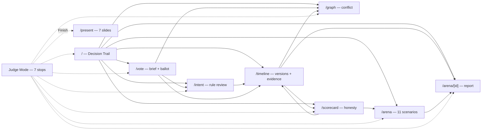
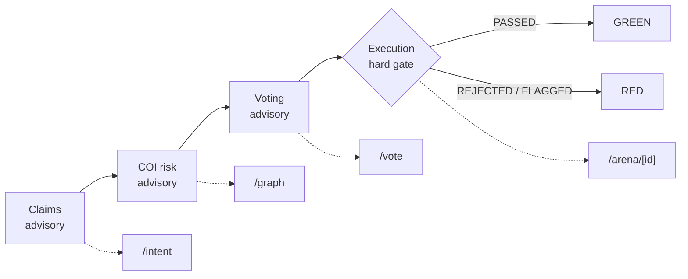
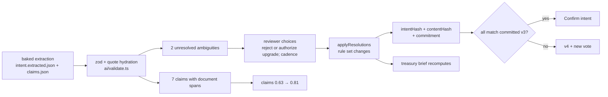
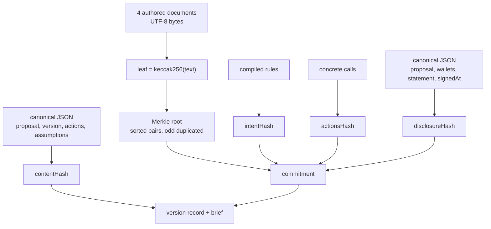
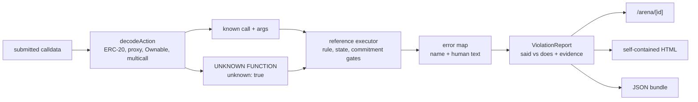
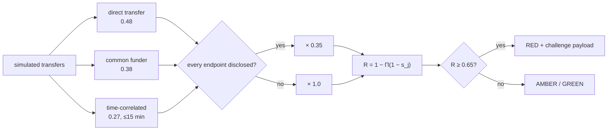
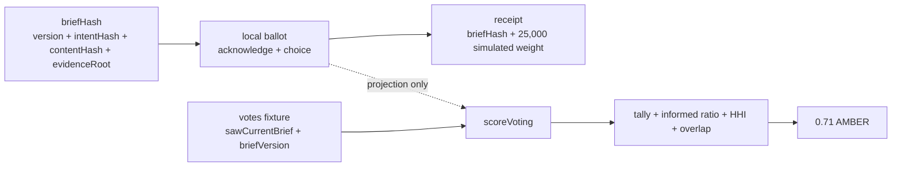
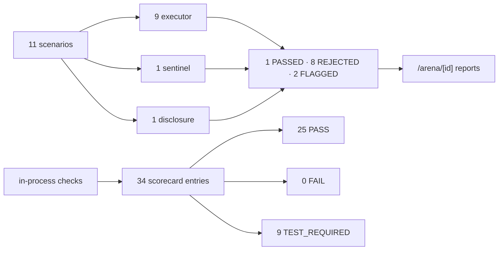
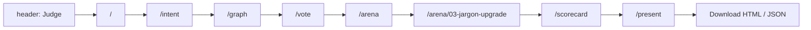
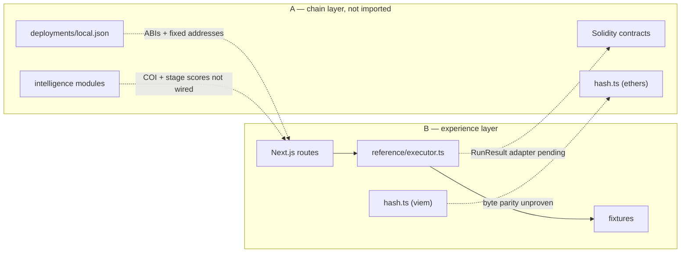

# 02 — Experience Layer

Scope: Person B at `ea78e84`; Person A at `55c636a` only at the boundary (§11). No app code or commit was touched. The 57-test suite, scorecard, production build and browser QA were run on the B code in the main workspace; this worktree has no `node_modules/`, so the counts below were source-checked against those artifacts and are not re-run here.

**Legend**

| Tag | Meaning |
| :-- | :-- |
| **verified** | Present in B and/or backed by a checked-in fixture or test artifact. |
| **simulated** | Fixture records labelled simulated; not chain data. |
| **reference model** | TypeScript model of intended behaviour; executes nothing. |
| **pending integration** | Specified but not wired to A's contracts or modules. |

---

## 1. Experience thesis

The promise: a vote should bind to the bytes it authorizes, and the console should make the gap between text, evidence, conflicts, vote and calldata the primary artifact. It shows the gate; it does not claim the gate is on-chain.

The three-minute story (targets, not measured):

1. **`/` — the verdict.** AIP-042 passed; the queued upgrade was never authorized.
2. **`/intent` — the rule set.** Resolve two ambiguities; four draft rules become three; hashes match v3; claims 0.63 → 0.81.
3. **`/graph` — the conflict.** Two disclosed wallets, four links, risk 0.88.
4. **`/vote` — the consent.** 59% informed; a 90,000-weight FOR voter overlaps a flagged wallet.
5. **`/arena` + report — the artifact.** Benign passes; upgrade rejected; quote beside decode.
6. **`/scorecard` — the boundary.** 25 pass, 0 fail, 9 `TEST_REQUIRED`; nine on-chain claims not made.

---

## 2. Route and journey map

| Route | Answers | On screen / exits |
| :-- | :-- | :-- |
| `/` | Why is a passed proposal blocked? | Verdict, four stages, gap; links to report, intent, arena, vote, timeline, scorecard |
| `/intent` | What will the vote authorize? | 7 sourced claims, 2 ambiguities, live rules/hashes; `/timeline` after confirm |
| `/timeline` | Which versions and documents are bound? | 3 versions, 4 proofs, disclosure; links to graph, report, scorecard |
| `/graph` | Is the disclosure complete? | 2 disclosed vs 3 discovered, 4 links, challenge; stays on page |
| `/vote` | Was the vote informed? | Brief, tally, informed ratio, overlap, ballot, receipt; links to intent, graph, timeline, report |
| `/arena` | Which layer refuses which attack? | 11 scenarios, expected vs actual; links to each report |
| `/arena/[id]` | What exactly was submitted? | Quote, decode diff, gates, constraint, evidence; back, HTML/JSON |
| `/scorecard` | What is proven, and what is not? | 34 checks, filters, raw JSON; links to arena, timeline |
| `/present` | Can the story run without the shell? | 7 slides, each links back; slide 7 downloads |

**Judge Mode** walks the seven stops in order (dotted in the diagram), with `Alt+←/→`, `Esc`, Finish → `/present`; it skips `/timeline`, still in nav.

---

## 3. Decision Trail

`chain-scoring/score.ts`: three advisory stages, one gate; execution has no score.

| Stage | Formula | Thresholds | AIP-042 |
| :-- | :-- | :-- | :-- |
| Claims | `mean(confidence_i × (1 if linked ambiguity resolved else support_i)) × 1/(1 + 0.12×open) × (1 − 0.05×resolved)` | GREEN ≥ 0.80, AMBER ≥ 0.60, else RED | **0.81 GREEN**; 0.63 as extracted |
| COI | `1 − Π(1 − s_j)`, `s_j = base_j × 0.35` if every endpoint disclosed, else `× 1`; bases 0.48 / 0.38 / 0.27 | RED ≥ 0.65, AMBER ≥ 0.35, else GREEN; higher is worse | **0.88 RED** |
| Voting | `0.30×quorumHealth + 0.20×supportRatio + 0.35×informedRatio + 0.15×(1−HHI) − 0.05×overlap` | GREEN ≥ 0.80, AMBER ≥ 0.55, else RED | **0.71 AMBER** |
| Execution | `score = null`; `PASSED` → GREEN, else RED | binary | **RED**, `SelectorNotAuthorized` |

A failing gate cannot be offset by an advisory score. Every stage carries factors and a drilldown.

---

## 4. Intent review loop

Baked extraction, live validation, human resolution. No model is called at demo time.

**verified** (`app/intent/IntentReview.tsx`, `ai/validate.ts`, `ai/resolve.ts`, `ai/brief.ts`, `lib/demo.ts`):

- 7/7 claims source-linked; `c6` at 42% carries the tentative upgrade; two unresolved items (`upgrade-scope`, `cadence`).
- Reviewer changes rules: reject removes the tentative `UPGRADE`; authorize keeps it; recurring raises GrowthLabs to 800,000 USDC.
- Prefill reject + one-time: 3 rules, claims 0.81; intent, content and commitment hashes match v3.
- Confirm only when no ambiguity remains and hashes match; otherwise v4 + new vote.
- Brief recomputes: 250,000 grants, 5,000 allowance, 7.8 months; recurring 850,000 triggers a below-four-months warning.

Sources and confidence never enter `intentHash`; assumptions enter `contentHash`; concrete calls enter `actionsHash`.

---

## 5. Evidence and hashes

**verified** (`evidence/merkle.ts`, `packages/shared/hash.ts`, `lib/demo.ts`): four content-addressed seeds hash to a root with two-sibling proofs. `commitment = keccak256(chainId, executor, proposalKey, version, actionsHash, intentHash, evidenceRoot, disclosureHash)`; `contentHash` is not a commitment field. `briefHash` covers proposalId, version, intentHash, contentHash, evidenceRoot.

Three versions: v1 one rule and v2 three rules share an early three-document root; v3 adds the technical assessment. v2 → v3 keeps `intentHash` but moves `contentHash`, root and commitment. “Anchored in v3” means recorded in that version; every hash is local, with no registry anchoring — **pending integration**.

---

## 6. Decode and report

**verified** (`sentinel/decode.ts`, `sentinel/report.ts`, `reference/executor.ts`, `lib/report-export.ts`): the decoder tries ERC-20, proxy, Ownable and multicall ABIs, recurses to depth 3, and flags unknown selectors as `UNKNOWN FUNCTION 0x…`. Seventeen errors map selector → name → text; the report is assembled from the run result, never prose.

The primary artifact, `/arena/03-jargon-upgrade`: the quote “align the treasury implementation…” beside one `upgradeTo(address)`; 3 committed actions vs 1 submitted; `REJECTED SelectorNotAuthorized` (`0x1420732b`); commitments, calldata hash, revert data, simulated tx hash, no trace reference. HTML repeats quote, decode, gates, constraint, evidence; JSON is the machine bundle.

---

## 7. Wallet graph and COI

**verified code, simulated data** (`graph/discover.ts`, `app/graph/GraphView.tsx`, `packages/shared/fixtures/graph.json`): direct-transfer, common-funder, time-correlation detectors; `SHARED_DEPLOYER` is a placeholder. Four links: 0.48, 0.48, 0.38, 0.27; noisy-OR 0.88 RED. Every demo link touches an undisclosed endpoint, so damping does not apply. Two disclosed, three discovered wallets.

The payload carries proposal id, disclosure hash, claim, risk, threshold, filer/date, per-link evidence; its digest is `keccak256(canonical JSON)`. `FILED` is fixture state; on-chain verification is **pending integration**. Addresses and transfers are **simulated**; the arithmetic is real. This is a risk signal, not wrongdoing.

---

## 8. Informed voting

**verified code over simulated votes** (`chain-scoring/score.ts`, `app/vote/VoteView.tsx`, `ai/brief.ts`): 1,000,000 eligible, 40% quorum, 780,000 cast (78%), FOR 500,000, AGAINST 230,000, abstain 50,000, support 68.5%, informed 460,000 (59%), HHI 0.23, one 90,000-weight FOR overlap (−0.05), 0.71 AMBER.

The ballot is labelled `voteWithBrief`, but B has no such contract method: the vote is local, adds 25,000 simulated weight, and projects the tally. The receipt records brief hash, choice, weight; nothing is broadcast. The on-chain method is **pending integration**; fixtures use `sawCurrentBrief` and `briefVersion`.

---

## 9. Red-team arena and scorecard

**verified** (`packages/shared/fixtures/scenarios.json`, `app/arena/ArenaRunner.tsx`, `scripts/scorecard.ts`, `packages/shared/fixtures/scorecard.json`): 11 scenarios on three layers, expected vs actual. `Run` only paces precomputed steps; it does not execute live.

Scorecard semantics: `PASS` means a check ran when the fixture was generated; `FAIL` would block; `TEST_REQUIRED` means the property cannot be honestly tested without Solidity, a Hardhat run or a fork, and is never green. 34 entries: 25 PASS, 0 FAIL, 9 TEST_REQUIRED; 14 unit, 11 reference-model, 9 pending-solidity. A reference run, not coverage. Vitest is recorded as 57 tests in 9 files.

---

## 10. Judge Mode, presentation, report

**verified** (`components/JudgeMode.tsx`, `app/present/page.tsx`, `app/present/PresentationView.tsx`, `components/ArenaDetail.tsx`, `components/ReportDownload.tsx`, `lib/report-export.ts`): Judge Mode has seven stops, Back/Next, `Alt+←/→`, `Esc`, Finish → `/present`. `/present` bypasses the shell and runs seven slides: verdict, trail, gap, conflict, vote, execution gate, what we can prove. Keys: arrows, space, `PageUp/PageDown`, `Home/End`, `F`; each slide links back.

The download is client-side: self-contained HTML with print CSS, or JSON. It sits in Takeaway on `/arena/[id]` and slide 7. Filename: `aegis-aip-042-03-jargon-upgrade.html` / `.json`.

---

## 11. Boundary to Person A

**verified boundary**: B has no Solidity, Hardhat, chain or LLM and imports nothing from A's `contracts/`, `intelligence/` or `deployments/`. B derives addresses in `packages/shared/addresses.ts`; A deploys fixed Hardhat addresses. ABIs, errors and hash preimages diverge, including duplicate `hash.ts`, `decode.ts` and `report.ts` paths with different content. Histories are unrelated (`55c636a` vs `ea78e84`) with eight overlapping paths.

The nine `TEST_REQUIRED` rows mean **B is not wired to A's contracts and cannot test those properties** — not that A produced nothing. A's tree carries checked-in Hardhat-run artifacts: `deployments/local.json` (11 ABIs), an 11-row all-PASS scorecard, 10 parity vectors, 11 sentinel reports and TypeChain for `CommitmentHasher`. No full `artifacts/` build directory is checked in, and A's suite was not re-run here. Do not merge either scorecard or hash file wholesale. See `docs/atlas/01-chain-intelligence.md`.

---

## 12. File map

| Path | Why it matters |
| :-- | :-- |
| `lib/demo.ts` | Cached demo object |
| `chain-scoring/score.ts` | Trail and formulas |
| `app/intent/IntentReview.tsx` | Reviewer loop and hashes |
| `ai/validate.ts`, `ai/resolve.ts`, `ai/brief.ts` | Validation, resolutions, brief |
| `evidence/merkle.ts`, `packages/shared/hash.ts` | Proofs and hashing |
| `sentinel/decode.ts`, `sentinel/report.ts` | Decode and report |
| `graph/discover.ts` | Links, damping, noisy-OR |
| `reference/executor.ts` | Enforcement model |
| `components/JudgeMode.tsx`, `app/present/PresentationView.tsx` | Spine and deck |
| `components/ReportDownload.tsx`, `lib/report-export.ts` | HTML/JSON export |
| `scripts/scorecard.ts`, `packages/shared/fixtures/scorecard.json` | Gap accounting |
| `docs/atlas/01-chain-intelligence.md` | A layer and collisions |
