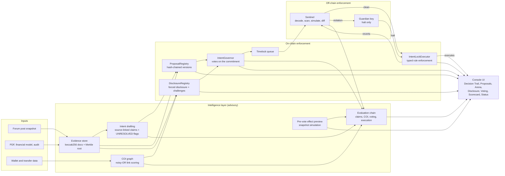
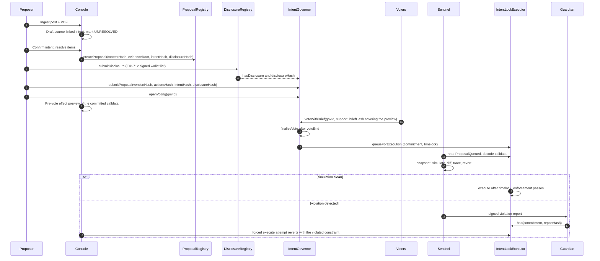
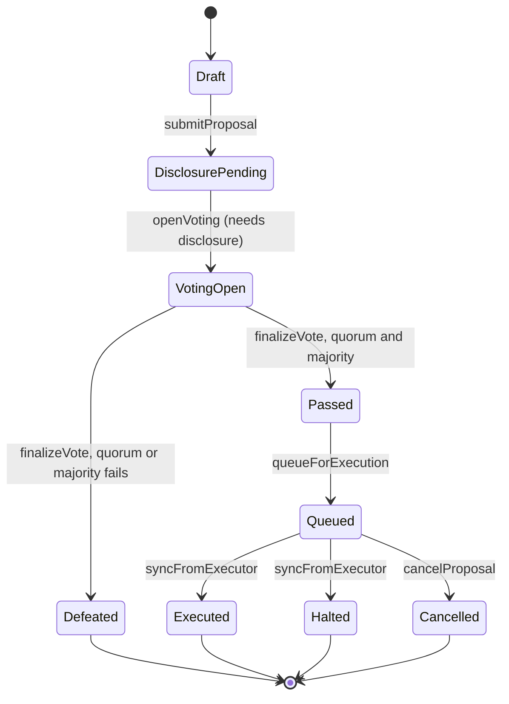
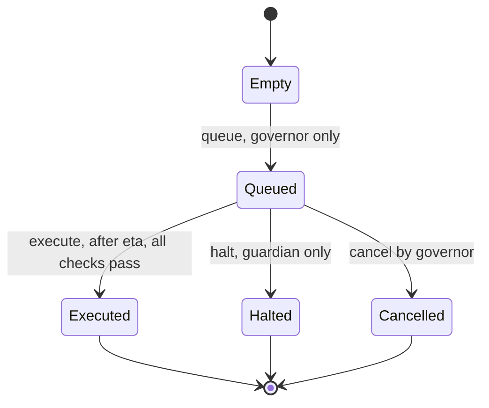
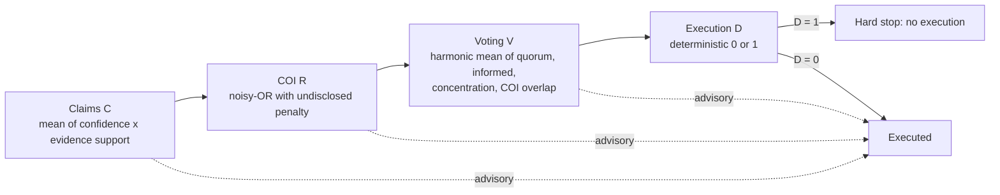

# Architecture

How the pieces fit together, and where each piece lives in the repository.

## System map

The arrow that matters: **the LLM and the scores never touch the executor**. Only the
commitment and the typed rules decide whether bytes run.

## One proposal, end to end

## Proposal state machines

Governor states (`IntentGovernor.GovProposalState`):

Executor states (`IntentLockExecutor.ProposalState`):

## Three enforcement layers

| Layer | Where | Role | Trust level |
| :--- | :--- | :--- | :--- |
| Protected Executor | On-chain (`IntentLockExecutor` + `ActionDecoder`) | Reverts anything outside the commitment and the typed rules | Cryptographic and deterministic. This is the security claim. |
| Sentinel | Off-chain (`sentinel/`), simulation on Hardhat or a Sepolia fork | Early warning, evidence, plain-English explanation, guardian halt | Deterministic checks, limited to what simulation can observe |
| AI drafting, scoring, preview commentary | Off-chain (`intelligence/`, `sentinel/preview.ts`) | Helps humans read and compare; never approves or enforces | Advisory. Every output is source-linked or simulation-derived, and a human confirms the intent |

## The commitment

The vote binds: chain id, executor address, proposal id, version, version hash, actions hash,
intent hash and disclosure hash. The full formula, the `Version` struct and the reasoning are
in [CONTRACTS.md](CONTRACTS.md#the-commitment).

## Evaluation chain

`intelligence/chain.ts` implements the four scorers; `sentinel/preview.ts` feeds the claims
factor with real simulation mismatches. The formulas and thresholds are documented in the
README's evaluation-chain section and in the source (`CONFIG` at the top of `chain.ts`).

## Module map

| Concern | Code |
| :--- | :--- |
| Contracts and tests | `contracts/`, `test/redteam/` |
| Commitment hashing (Solidity + TypeScript parity) | `contracts/CommitmentHasher.sol`, `packages/shared/hash.ts`, `test/commitment-parity.test.ts` |
| Evidence store, Merkle manifest, source verification | `intelligence/evidence.ts`, `intelligence/evidence-verify.ts` |
| Intent drafting, confirmation, bridging to rules | `intelligence/ai-draft.ts`, `intelligence/intent-bridge.ts` |
| COI graph and noisy-OR | `intelligence/graph.ts` |
| Evaluation chain | `intelligence/chain.ts` |
| Local benefit classifier and decision CLI | `intelligence/tiny-model.ts`, `intelligence/recommendation.ts`, `scripts/decide.ts` |
| Sentinel decode, scan, simulate, diff, trace, halt | `sentinel/` |
| Pre-vote effect preview | `sentinel/preview.ts`, `sentinel/preview-cli.ts` |
| Snapshot mutex shared by preview, watcher and arena | `sentinel/mutex.ts` |
| Shared schemas, fixtures, error catalog | `packages/shared/` |
| Contract-wired console (Next.js) | `app/` |
| Editorial console, atlas and Ledger signing (Next.js) | `console/` |
| Deploy, seed, verify, preview recording | `scripts/` |
| Deployment manifests (addresses, ABIs, args, blocks) | `deployments/` |
